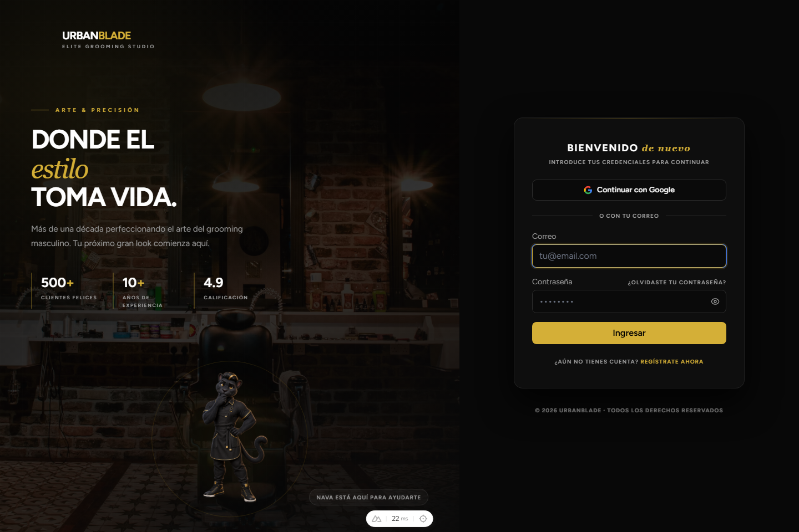

# Manual de Usuario

Guía de uso de UrbanBlade para clientes, barberos, recepción, administración e ingeniería.

| Dato | Valor |
| --- | --- |
| Documento | Manual de Usuario de UrbanBlade (web y aplicación Android) |
| Versión | 2.0 · 28 de octubre de 2026 |
| Audiencia | Cliente, barbero, recepcionista, administrador e ingeniero |
| Fuente | Código del backend (`barber`) y del frontend (`frontend-urban`) revisados en esa fecha |
| Clasificación | Uso general. No contiene contraseñas, claves ni datos de personas reales |

## 1. Cómo usar este manual

UrbanBlade es el sistema de una barbería para reservar citas, cobrarlas, vender productos y premiar a los clientes que vuelven. Se usa desde el navegador (web instalable como aplicación) o desde la aplicación Android; las dos muestran la misma información porque consultan la misma API.

El sistema reconoce cinco roles. Al entrar, **detecta tu rol automáticamente** y te muestra solo el menú que te corresponde.

| Rol | Para qué sirve | Capítulo |
| --- | --- | --- |
| Cliente | Reservar, pagar, comprar y acumular beneficios. | 3 |
| Barbero | Atender su agenda, su horario y su portafolio. | 4 |
| Recepcionista | Operar el día: citas, cobros, pedidos y clientes. | 5 |
| Administrador | Configurar y analizar todo el negocio. | 6 |
| Ingeniero | Revisar el estado técnico del sistema, solo lectura. | 7 |

> **Nota** Los nombres de los botones pueden variar ligeramente con la versión instalada. Lo que se describe aquí es el comportamiento del sistema: los permisos y los importes los decide siempre el servidor, no la pantalla.

## 2. Entrar al sistema

### 2.1 Crear una cuenta (clientes nuevos)

1. Abre la dirección de la barbería en tu navegador.
2. Pulsa **Reservar** en la página principal, o **Acceso** en la esquina superior derecha y luego **Crear cuenta**.
3. Escribe tu nombre, correo, teléfono y una contraseña. El sistema indica qué tan segura es.
4. Revisa tu correo: llega un **código de verificación de 6 dígitos**. Escríbelo para activar la cuenta.

También puedes entrar con **Google**. El registro público y Google solo crean cuentas de **cliente**: el personal (barberos, recepción, administradores) lo da de alta un administrador.

### 2.2 Iniciar sesión

1. Pulsa **Acceso**, escribe tu correo y tu contraseña.
2. El sistema abre el panel de tu rol.
3. La sesión se mantiene mientras uses el sistema. Si pasas muchos días sin entrar, te pedirá iniciar sesión otra vez; en la web el límite de inactividad es de 30 días y en el móvil de 180.

### 2.3 Olvidé mi contraseña

1. En la pantalla de acceso pulsa **¿Olvidaste tu contraseña?**.
2. Escribe tu correo. Por seguridad el sistema responde igual exista o no la cuenta.
3. Abre el enlace que llega a tu correo y define una contraseña nueva.

### 2.4 Instalar la aplicación

- **Web instalable (PWA):** desde el navegador del teléfono o la computadora, elige *Instalar* o *Agregar a la pantalla de inicio*. Funciona como una aplicación y recibe avisos. No permite reservar ni cobrar sin conexión.
- **Android:** instala la aplicación de UrbanBlade que te entregue la barbería. Es la misma cuenta y los mismos datos que la web.

### 2.5 Tema visual

La interfaz tiene cuatro temas (**noir**, **acero**, **salon** y **libreta**). Cambian colores y estilo, nunca permisos ni funciones.

## 3. Rol: Cliente

El menú del cliente se agrupa en tres secciones, además de **Dashboard**, **Muro Inspiración** y **Notificaciones**.

| Sección | Opciones |
| --- | --- |
| Reservar | Mis Citas, Nuestros Barberos, Lista de Espera |
| Tienda | Tienda, Carrito, Mis Pedidos, Mis Recibos |
| Beneficios | Membresía, Paquetes, Gift Cards, Referidos, Recomendado para ti |

### 3.1 Reservar una cita

1. Pulsa **Reservar** (o **Mis Citas** → nueva cita).
2. Elige el **servicio**, el **barbero** y el **día**.
3. El sistema muestra solo los **horarios realmente libres** de ese barbero.
4. Elige la hora y confirma. Si alguien tomó el horario un instante antes, el sistema te lo dice y te pide escoger otro.

Una cita nueva queda **pendiente** hasta que el barbero o la recepción la **confirman**. Según la configuración de la barbería, la reserva puede pedir un **depósito** o la aceptación de políticas de cancelación.

### 3.2 Estados de una cita

| Estado | Qué significa |
| --- | --- |
| Pendiente | Reservada, esperando confirmación. |
| Confirmada | Aceptada por la barbería. |
| En proceso | El servicio ya comenzó. |
| Completada | Servicio terminado. Suma puntos y avance de nivel. |
| Cancelada | Cancelada por ti o por la barbería. |
| No asistió | No llegaste a la hora. Puede generar un cargo si la barbería lo tiene activado. |

### 3.3 Ver, mover o cancelar una cita

- En **Mis Citas** ves tus citas próximas y el historial.
- Puedes **cancelar** o **mover** una cita mientras la política de la barbería lo permita; fuera de esa ventana el sistema no ofrece la acción y te explica el motivo.
- También puedes gestionar tu cita desde el **enlace que llega por correo**, sin iniciar sesión.

### 3.4 Lista de espera

Si el horario que quieres está lleno, anótate en **Lista de Espera**. Si se libera un lugar, el sistema te avisa. Las anotaciones con fecha pasada caducan solas.

### 3.5 Pagar

Los métodos de pago son **efectivo**, **transferencia** y **tarjeta** (con Stripe). Puedes guardar tarjetas y pagar propinas. En una transferencia se sube el comprobante y la barbería lo revisa antes de darlo por pagado. Los importes, descuentos y puntos los calcula el servidor.

> **Importante** Pagar una cita no es lo mismo que completarla: una cita pagada sigue pendiente de atención hasta que el barbero termine el servicio.

### 3.6 Tienda, carrito y pedidos

1. En **Tienda** elige productos y agrégalos al **Carrito**.
2. Confirma el pedido. Puedes agregar productos a una cita como complemento.
3. Sigue el pedido en **Mis Pedidos**. La entrega se hace en recepción; un pedido no recogido en 3 días se cancela y el producto vuelve al inventario.
4. En **Mis Recibos** descargas tus comprobantes en PDF.

> **Aviso** Los recibos de UrbanBlade son comprobantes del servicio o la compra; **no son facturas fiscales (CFDI)**.

### 3.7 Lealtad, puntos y niveles

Cada cita **completada** suma avance. El nivel sube con las citas completadas y trae un descuento:

| Nivel | Citas completadas | Descuento |
| --- | --- | --- |
| Caballero | 0 | 0 % |
| Regular | 5 | 5 % |
| V.I.P | 10 | 10 % |
| Leyenda | 20 | 15 % |

- Ganas **10 puntos** por cada cita completada y **5 puntos** por una reseña.
- Puedes pagar con puntos hasta el **50 %** del total ya con descuento.
- Si pasas **180 días sin una cita completada** bajas un nivel, y a los **365 días** tus puntos caducan.
- Cada mes hay un **sorteo** entre clientes elegibles.

### 3.8 Membresía, paquetes, gift cards y referidos

- **Membresía:** plan de suscripción de la barbería. Cobra con tarjeta y genera tus recibos de suscripción.
- **Paquetes:** compras servicios prepagados con saldo y vigencia.
- **Gift cards:** regalas saldo a otra persona.
- **Referidos:** invitas a un amigo y ambos reciben su beneficio cuando él completa su primera cita.

### 3.9 Reseñas, muro y asistente

- Puedes **reseñar** a tu barbero al terminar el servicio.
- El **Muro Inspiración** muestra el portafolio de los barberos: puedes reaccionar, guardar y comentar. Los comentarios pasan por moderación y puedes reportar o bloquear contenido.
- El **asistente virtual** (Bladebot) responde dudas sobre servicios, horarios y tu cuenta desde el chat.

### 3.10 Tu perfil y tus avisos

En **Perfil** actualizas tus datos, tu foto y tus preferencias de notificación. Desde **Notificaciones** ves todos tus avisos. Los recordatorios llegan por correo, por avisos del navegador o de la aplicación y, si están activados, por SMS o WhatsApp.

## 4. Rol: Barbero

Menú: **Mi Agenda**, **Mi Calendario**, **Mi Portafolio**, **Mi Horario**, además de Dashboard, Muro y Notificaciones. Tu perfil se abre desde tu avatar.

### 4.1 Tu agenda

1. En **Mi Agenda** ves las citas del día con su estado.
2. Cuando llega una solicitud, **acéptala** (confirmada) o recházala (cancelada).
3. Llegada la hora, pulsa **Iniciar**. El sistema valida la fecha, el margen de tiempo y que el pago esté resuelto antes de dejarte iniciar.
4. Al terminar, pulsa **Completar**. Esto suma puntos al cliente y registra tu comisión.

### 4.2 Avisos durante el servicio

Cinco minutos antes de que termine el servicio recibes un aviso con dos opciones: **terminar ya** o **agregar tiempo**. Si el servicio se alarga más de lo esperado, el sistema te avisa.

### 4.3 Horario, calendario y portafolio

- **Mi Horario:** define tus días y horas de trabajo; la disponibilidad que ven los clientes sale de aquí.
- **Mi Calendario:** vista mensual y semanal de tus citas.
- **Mi Portafolio:** publica fotos de tus trabajos para el Muro.

### 4.4 Tu desempeño

Tu panel muestra tus citas, ingresos, calificación y oportunidades. El administrador recibe un reporte mensual de desempeño.

## 5. Rol: Recepcionista

Menú: **Citas**, **Calendario**, **Clientes**, **Pagos**, **Pedidos**, **Movimientos** (inventario), **Gift Cards**, **Paquetes**, **Lista de Espera** y **Analítica**.

### 5.1 Un día de trabajo

1. Abre **Citas** o **Calendario** y revisa la agenda.
2. Confirma las citas pendientes y registra **clientes sin cita** (walk-in).
3. Cobra desde **Pagos**: efectivo, transferencia (revisa el comprobante) o tarjeta.
4. Entrega los **Pedidos** de tienda cuando el cliente los recoge.
5. Al cerrar, haz el **cierre de caja** del turno.

### 5.2 Reglas importantes

- Solo se puede **cobrar** una cita confirmada, en proceso o completada.
- No puedes cambiar un importe a mano para saltarte descuentos o puntos: el servidor calcula el total.
- Los depósitos y los cargos por inasistencia tienen su propio flujo en **Pagos**.

## 6. Rol: Administrador

El administrador tiene el menú más amplio, organizado en secciones.

| Sección | Opciones |
| --- | --- |
| Operación | Citas, Calendario, Clientes, Pagos, Pedidos, Movimientos, Gift Cards, Paquetes, Lista de Espera |
| Gestión | Barberos, Planes de Membresía, Reseñas, Moderación del muro, Usuarios, Servicios, Productos, Configuración |
| Análisis | Analítica, Reportes, Campañas, Sorteos, Logs |
| Sistema | Estado del Servidor |

### 6.1 Personal, servicios y productos

- **Usuarios:** alta del personal y asignación de roles. Los roles privilegiados solo los asigna un administrador.
- **Barberos:** perfil, comisión y activación de cada barbero.
- **Servicios y combos:** catálogo, precio y duración.
- **Productos:** venta y uso interno, con movimientos de inventario y alertas de stock bajo.

### 6.2 Configuración

En **Configuración** se ajustan datos de la barbería, políticas de cancelación, depósitos y avisos. Un cambio aquí puede afectar reservas, pagos y notificaciones: revisa el impacto antes de guardar.

### 6.3 Reportes, analítica y campañas

- **Reportes:** citas, ingresos, inventario, clientes y horas pico; se exportan a PDF y Excel.
- **Analítica:** hallazgos automáticos (clientes en riesgo, demanda, alertas de cancelación).
- **Campañas:** correos inmediatos o programados, segmentados por nivel de lealtad.
- **Sorteos:** sorteo mensual de lealtad.
- **Logs:** bitácora de actividad del sistema.

### 6.4 Moderación

En **Moderación del muro** revisas los comentarios y los reportes de los usuarios y puedes ocultar contenido.

## 7. Rol: Ingeniero

Es un rol técnico de **solo lectura**. Su menú tiene **Dashboard**, **Notificaciones**, **Reportes**, **Logs** y **Estado del Servidor**. Ve el estado de los servicios, la actividad y el rendimiento, pero no administra el negocio ni modifica datos.

## 8. Pagos, recibos y membresías

| Tema | Cómo funciona |
| --- | --- |
| Efectivo | Se registra en recepción; entra al cierre de caja. |
| Transferencia | El cliente sube el comprobante; recepción lo revisa y lo marca como pagado. |
| Tarjeta | Se procesa con Stripe. Un aviso del proveedor puede completar el pago unos instantes después. |
| Depósito | Anticipo que puede pedir la reserva; se descuenta del total. |
| Inasistencia | Si la barbería lo activa, una cita marcada como *no asistió* puede generar un cargo. |
| Reembolso | Lo emite la barbería; el cliente recibe aviso. |
| Propina | Se agrega al cobrar y queda en el recibo. |

## 9. Notificaciones

La entrega depende de tus preferencias, de los canales activos y de la configuración del dispositivo. Un mensaje de "operación exitosa" no garantiza que el aviso llegue. Si no recibes avisos, revisa **Perfil → Notificaciones** y los permisos del navegador o del teléfono.

## 10. Preguntas frecuentes

| Pregunta | Respuesta |
| --- | --- |
| Reservé y mi cita sigue pendiente. | Es normal: toda cita nueva espera confirmación del barbero o de recepción. |
| No puedo iniciar una cita confirmada. | Aún no corresponde su horario, o falta resolver el pago. |
| Pagué y la cita no se completó. | Pagar no completa el servicio; lo hace el barbero al terminar. |
| No me llega el código de verificación. | Revisa spam; espera un minuto y solicita otro. |
| ¿Puedo reservar sin conexión? | No. La aplicación instalada abre sin red, pero reservar y pagar necesitan internet. |
| ¿Mi recibo es una factura? | No. No es un CFDI. |
| Olvidé mi contraseña. | Usa **¿Olvidaste tu contraseña?** en la pantalla de acceso. |

## 11. Si algo falla

Cuando una operación falle, anota **tu rol, qué intentabas hacer, la fecha y hora y el mensaje que apareció**. No compartas contraseñas, códigos, tokens ni comprobantes de otras personas. Comunícalo a la barbería. Si crees haber encontrado una vulnerabilidad, repórtala por el canal privado de seguridad del proyecto y no la publiques.
