# Manual de Usuario

Guía de uso de UrbanBlade para clientes, barberos, recepción, administración e ingeniería.

| Dato | Valor |
| --- | --- |
| Documento | Manual de Usuario de UrbanBlade (web y aplicación Android) |
| Versión | 2.0 · 28 de octubre de 2026 |
| Audiencia | Cliente, barbero, recepcionista, administrador e ingeniero |
| Fuente | Código del backend (`barber`) y del frontend (`frontend-urban`) revisados en esa fecha |
| Clasificación | Uso general. No contiene contraseñas, claves ni datos de personas reales |

## 1. Cómo usar este manual

UrbanBlade es el sistema de una barbería para reservar citas, cobrarlas, vender productos y premiar a los clientes que vuelven. Se usa desde el navegador (web instalable como aplicación) o desde la aplicación Android; las dos muestran la misma información porque consultan la misma API.

El sistema reconoce cinco roles. Al entrar, **detecta tu rol automáticamente** y te muestra solo el menú que te corresponde.

| Rol | Para qué sirve | Capítulo |
| --- | --- | --- |
| Cliente | Reservar, pagar, comprar y acumular beneficios. | 3 |
| Barbero | Atender su agenda, su horario y su portafolio. | 4 |
| Recepcionista | Operar el día: citas, cobros, pedidos y clientes. | 5 |
| Administrador | Configurar y analizar todo el negocio. | 6 |
| Ingeniero | Revisar el estado técnico del sistema, solo lectura. | 7 |

> **Nota** Los nombres de los botones pueden variar ligeramente con la versión instalada. Lo que se describe aquí es el comportamiento del sistema: los permisos y los importes los decide siempre el servidor, no la pantalla.

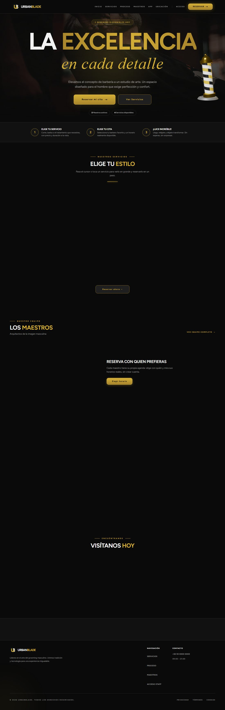

## 2. Entrar al sistema

### 2.1 Crear una cuenta (clientes nuevos)

1. Abre la dirección de la barbería en tu navegador.
2. Pulsa **Reservar** en la página principal, o **Acceso** en la esquina superior derecha y luego **Regístrate ahora**.
3. Escribe tu **nombre completo**, tu **correo** y una **contraseña**. Mientras escribes, el sistema indica qué tan segura es (de *Muy débil* a fuerte). Repite la contraseña en **Confirmar contraseña**.
4. Marca la casilla *Soy mayor de edad y acepto los Términos y Condiciones y el Aviso de Privacidad*. Hasta entonces el botón permanece atenuado.
5. Pulsa **Crear mi cuenta**. **No se pide ningún código por correo**: la cuenta queda lista y entras directamente.
6. Si falta algún dato, el sistema te lleva a **Completar perfil**, donde se piden tu teléfono, fecha de nacimiento y sexo. Sin esos datos no podrás reservar.

También puedes registrarte con **Continuar con Google**. El registro público y Google solo crean cuentas de **cliente**: el personal (barberos, recepción, administradores) lo da de alta un administrador.

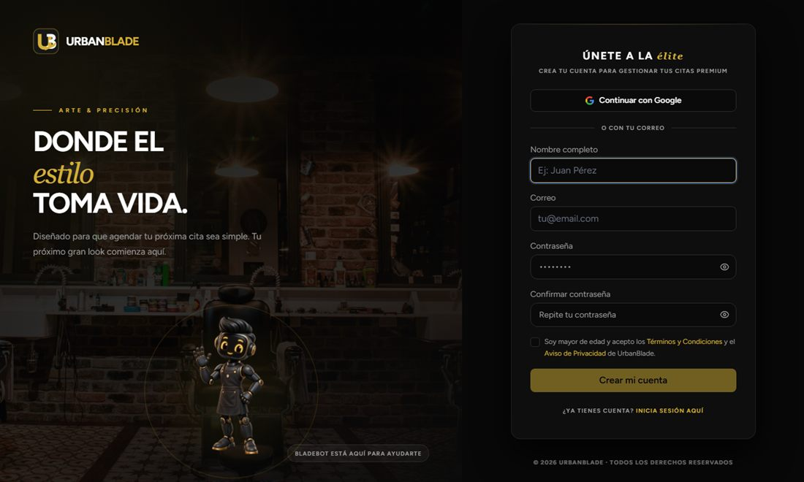

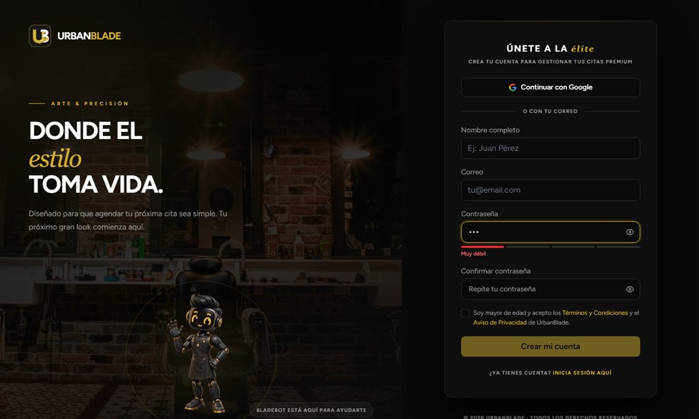

### 2.2 Iniciar sesión

1. Pulsa **Acceso**, escribe tu correo y tu contraseña (el ojo de la derecha muestra u oculta lo que escribes) y pulsa **Ingresar**. También puedes usar **Continuar con Google**.
2. El sistema detecta tu rol y abre el panel que le corresponde.
3. Si llegaste desde la reserva, vuelves a ella **con lo que ya elegiste**.
4. La sesión se mantiene mientras uses el sistema. Si pasas muchos días sin entrar, te pedirá iniciar sesión otra vez; en la web el límite de inactividad es de 30 días y en el móvil de 180.

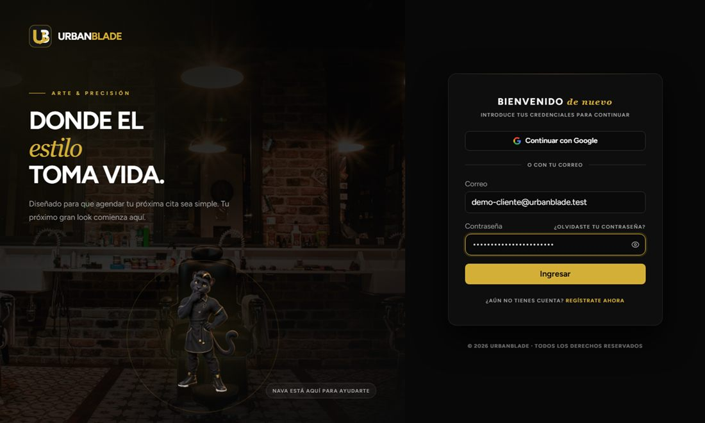

### 2.3 Olvidé mi contraseña

1. En la pantalla de acceso pulsa **¿Olvidaste tu contraseña?**.
2. Escribe tu correo. Por seguridad el sistema responde igual exista o no la cuenta.
3. Abre el enlace que llega a tu correo y define una contraseña nueva.

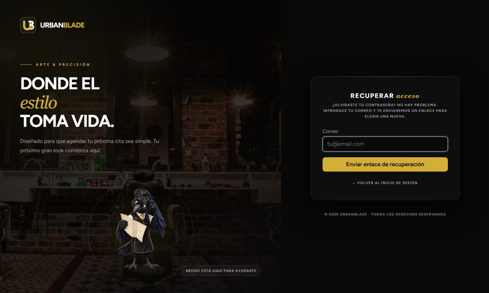

### 2.4 Instalar la aplicación

- **Web instalable (PWA):** desde el navegador del teléfono o la computadora, elige *Instalar* o *Agregar a la pantalla de inicio*. Funciona como una aplicación y recibe avisos. No permite reservar ni cobrar sin conexión.
- **Android:** instala la aplicación de UrbanBlade que te entregue la barbería. Es la misma cuenta y los mismos datos que la web.

### 2.5 Tema visual

La interfaz tiene cuatro temas (**noir**, **acero**, **salon** y **libreta**). Cambian colores y estilo, nunca permisos ni funciones. Se eligen en el selector **Tema** de la barra superior; el que aparece en las capturas es *Sastrería Nocturna*. Así se ve el mismo panel con el tema *Taller de Acero*:

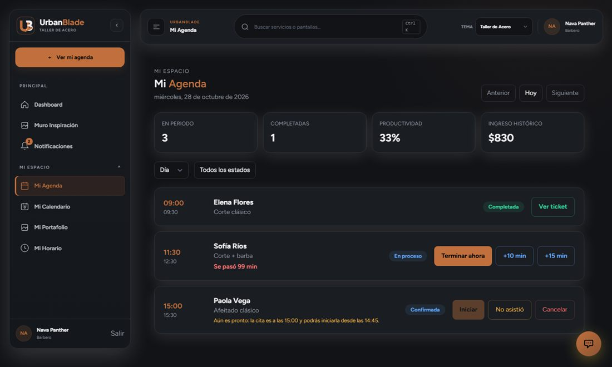

### 2.6 En el teléfono

En pantallas pequeñas el menú lateral se sustituye por una **barra inferior** con las secciones principales (Dashboard, Muro Inspiración, Mis Citas, Tienda) y un botón **Más** con el resto de opciones. El botón redondo del asistente queda flotando en la esquina inferior derecha.

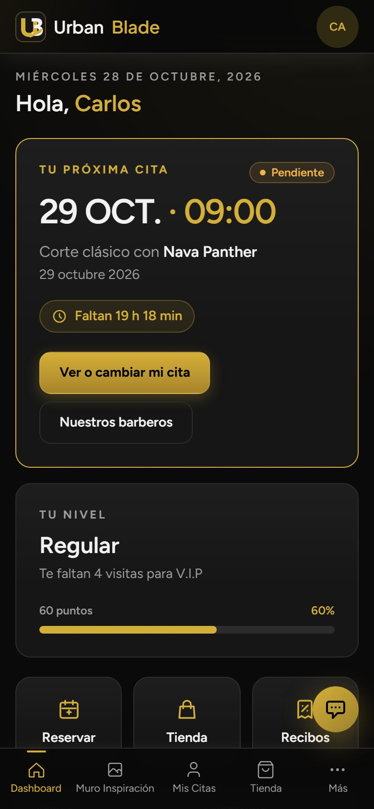

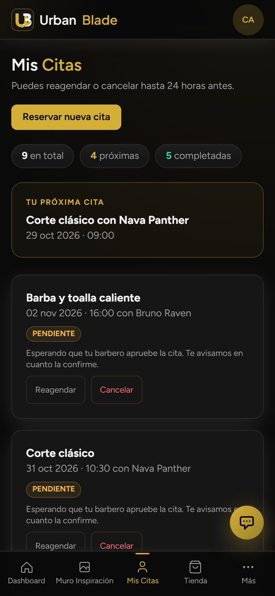

## 3. Rol: Cliente

El menú del cliente tiene tres secciones desplegables, además de **Dashboard**, **Muro Inspiración** y **Notificaciones**. Solo se despliega la sección en la que estás; pulsa el nombre de otra para abrirla.

| Sección | Opciones |
| --- | --- |
| Reservar | Mis Citas, Nuestros Barberos, Lista de Espera |
| Tienda | Tienda, Carrito, Mis Pedidos, Mis Recibos |
| Beneficios | Membresía, Paquetes, Gift Cards, Referidos, Recomendado para ti |

### 3.1 Tu panel

Al entrar ves tu panel (**Dashboard**):

- **Tu próxima cita**, con fecha, hora, servicio, barbero, su estado y cuánto falta, y los botones **Ver o cambiar mi cita** y **Nuestros barberos**.
- **Tu nivel** de lealtad, con tu avance hacia el siguiente nivel y tus puntos.
- Tres accesos rápidos: **Reservar**, **Tienda** y **Recibos**.
- Cuatro indicadores: **visitas**, **asistencia** (el porcentaje de citas a las que llegaste), **tu barbero** (con quien más reservas) y **puntos**.

El botón **Reservar cita** de la esquina superior derecha abre la reserva desde cualquier pantalla.

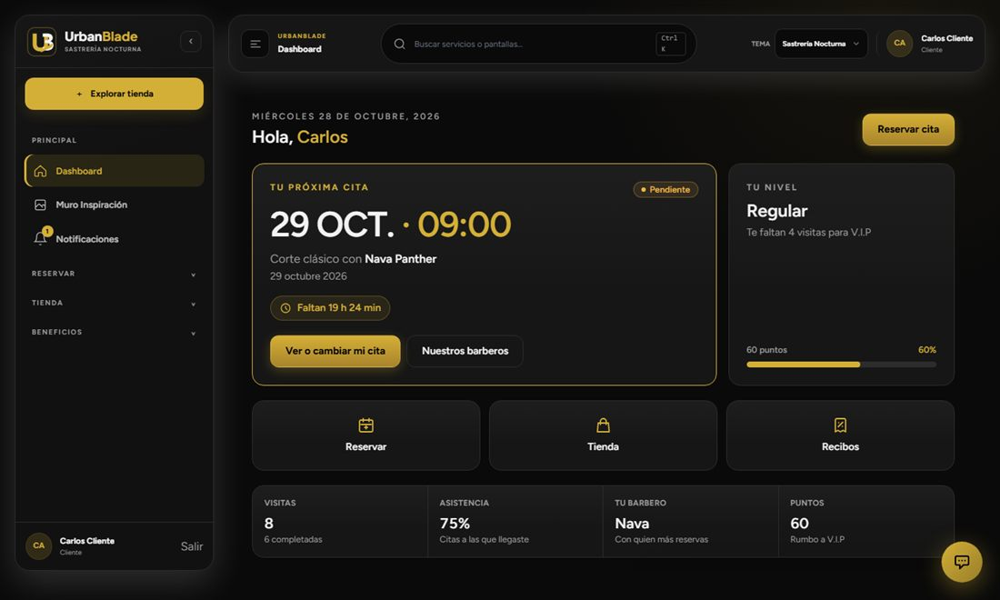

### 3.2 Reservar una cita

La reserva tiene cuatro pasos, siempre visibles arriba (**Servicio**, **Barbero**, **Horario** y **Confirmar**). Debajo de ellos queda un resumen con lo que llevas elegido. Puedes empezar sin cuenta; el sistema te la pide solo al confirmar.

1. **Servicio.** Elige el servicio; cada tarjeta muestra su duración y su precio.
2. **Barbero.** Elige al barbero. Si ya te atendió, la tarjeta dice *Ya te cortaste 2x con él*, y el corazón marca a tu favorito. **Ver perfil y portafolio** abre su perfil.
3. **Horario.** Elige el día en el selector de dos semanas (*Hoy* aparece marcado) y luego la hora. Los horarios se agrupan en **Mañana**, **Tarde** y **Noche** y el sistema indica cuántos hay libres ("23 horarios disponibles para jueves, 29 de octubre").
4. **Confirmar.** Revisa el resumen (servicio, barbero, cuándo, **descuento por tu nivel** y **total**). Puedes agregar productos de la tienda a tu cita, elegir **cuándo prefieres pagar** (*en el salón*, *ahora con tarjeta* o *ahora por transferencia*), escribir notas opcionales y aceptar el **cargo por inasistencia**. Pulsa **Confirmar cita**.

Al terminar aparece **Solicitud de cita registrada** con tu código, el servicio, el barbero y la fecha. La cita nace **pendiente** hasta que el barbero o la recepción la confirman.

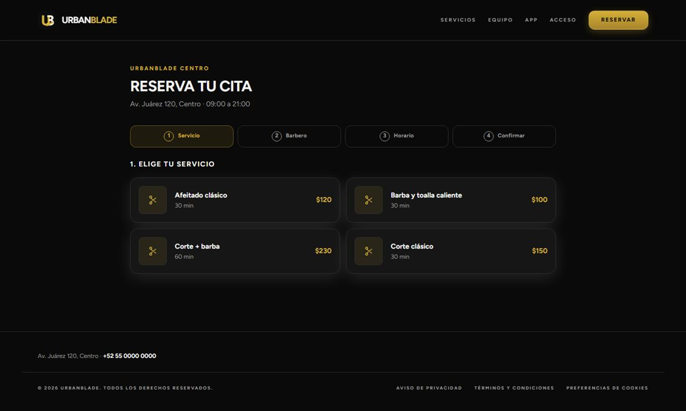

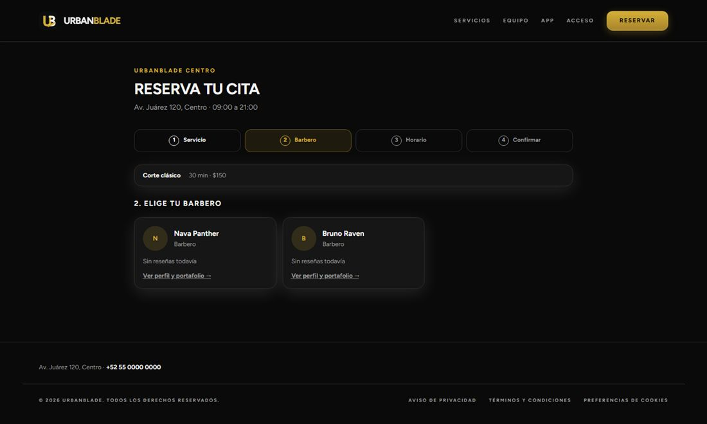

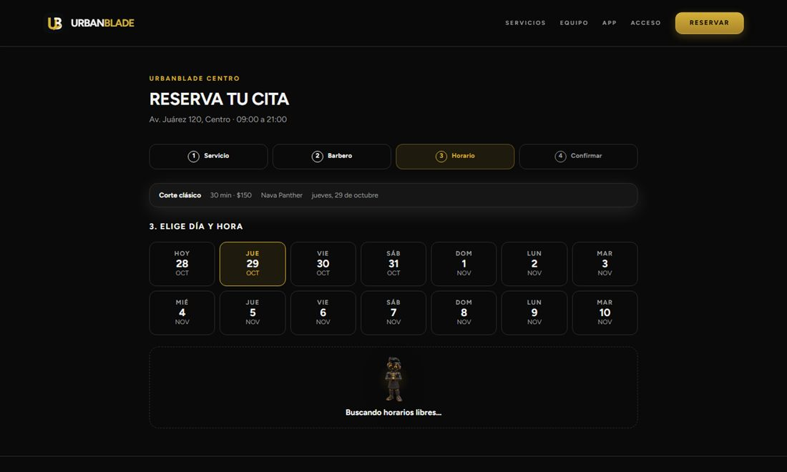

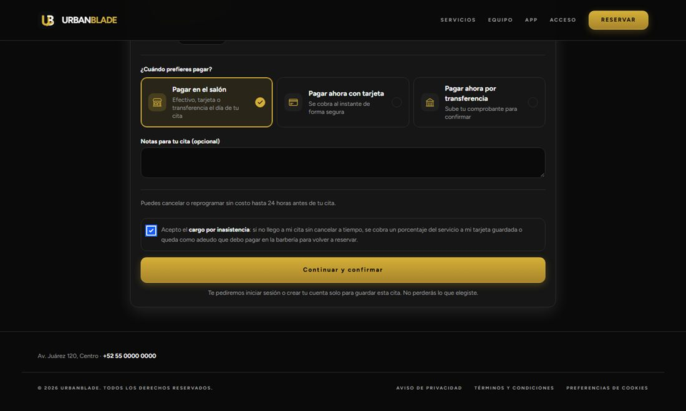

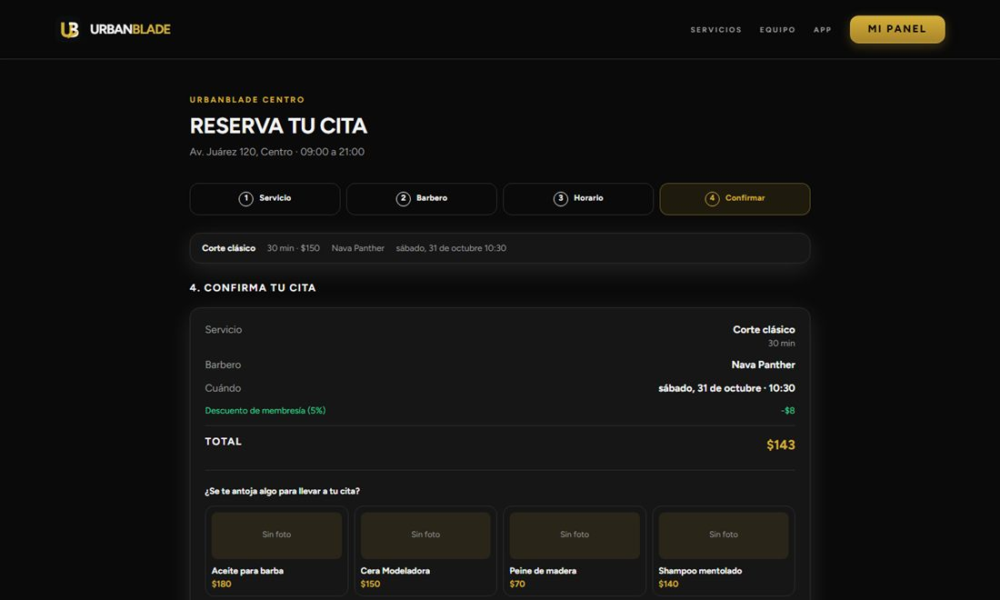

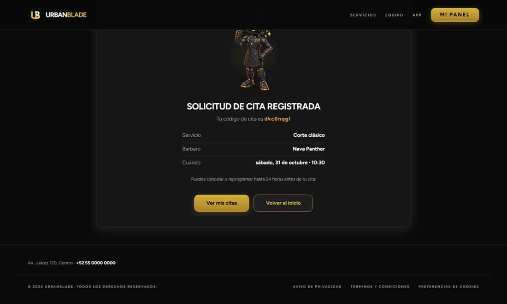

> **Importante** Solo se permite **una cita por día**. Si ya tienes una cita ese día, el sistema responde: "Ya tienes una cita agendada para el 29 de octubre de 2026. Solo se permite una cita por día."

> **Nota** Puedes cancelar o reprogramar sin costo hasta **24 horas antes** de tu cita. Si no llegas y no cancelaste a tiempo, se cobra un porcentaje del servicio a tu tarjeta guardada o queda como adeudo que debes pagar en la barbería para volver a reservar.

### 3.3 Estados de una cita

| Estado | Qué significa |
| --- | --- |
| Pendiente | Reservada, esperando confirmación. |
| Confirmada | Aceptada por la barbería. |
| En proceso | El servicio ya comenzó. |
| Completada | Servicio terminado. Suma puntos y avance de nivel. |
| Cancelada | Cancelada por ti o por la barbería. |
| No asistió | No llegaste a la hora. Puede generar un cargo si la barbería lo tiene activado. |

### 3.4 Mis citas: ver, pagar, reagendar o cancelar

En **Mis Citas** ves tres contadores (**en total**, **próximas** y **completadas**), tu próxima cita destacada y la lista de tus citas con su estado.

- Una cita **pendiente** dice *Esperando que tu barbero apruebe la cita. Te avisamos en cuanto la confirme* y ofrece **Reagendar** y **Cancelar**.
- Una cita **confirmada** dice que ya está aprobada y que **antes de que empiece el servicio debe estar pagada**: con tarjeta desde aquí (**Pagar con tarjeta**) o en recepción al llegar. También ofrece **Reagendar** y **Cancelar**.
- **Reagendar** abre una ventana donde puedes cambiar el barbero, el servicio, la fecha y la hora, y agregar notas. Pulsa **Reprogramar** para guardar o **Cancelar** para cerrar la ventana sin cambios.
- **Cancelar** pide confirmación: *¿Cancelar esta cita?*. Pulsa **Sí, cancelar** para cancelarla o **Cancelar** para volver.
- También puedes gestionar tu cita desde el **enlace que llega por correo**, sin iniciar sesión.

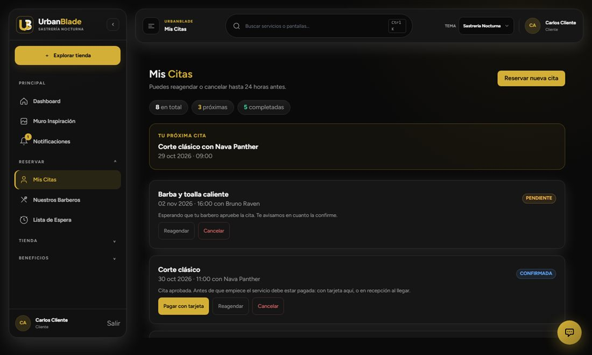

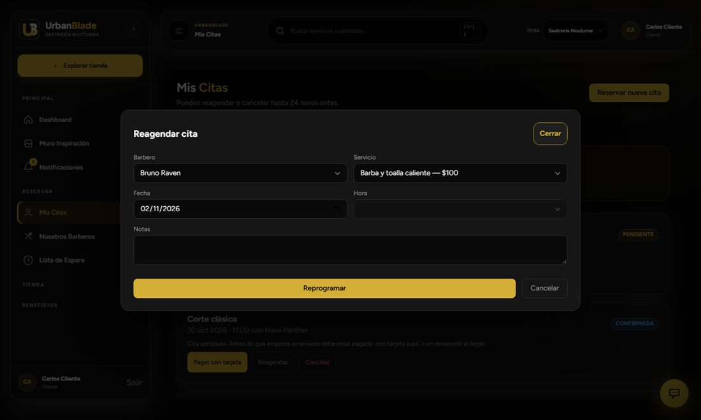

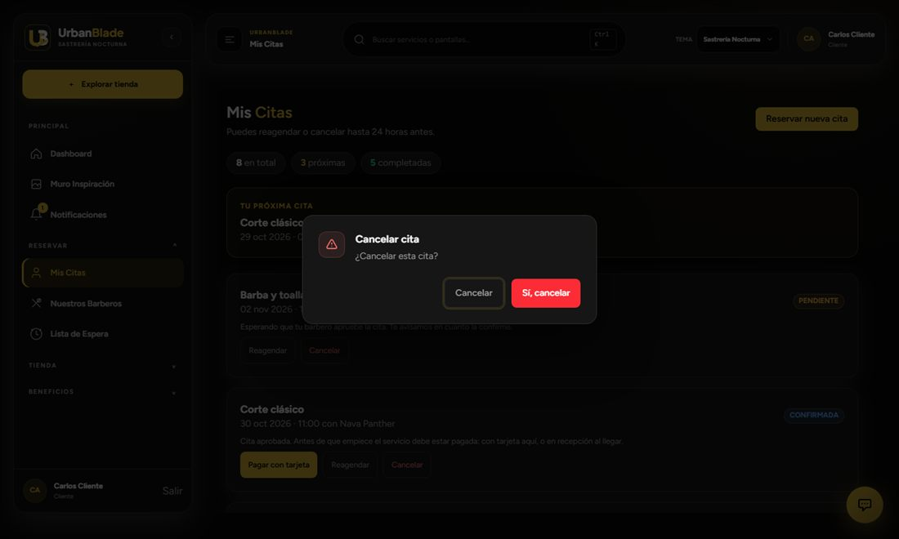

### 3.5 Lista de espera

Si el horario que quieres está lleno, anótate en **Lista de Espera**: elige barbero, servicio y fecha y pulsa **Anotarme**. Si se libera un lugar, el sistema te avisa. Tus anotaciones aparecen en **Mis anotaciones**; las que tienen fecha pasada caducan solas.

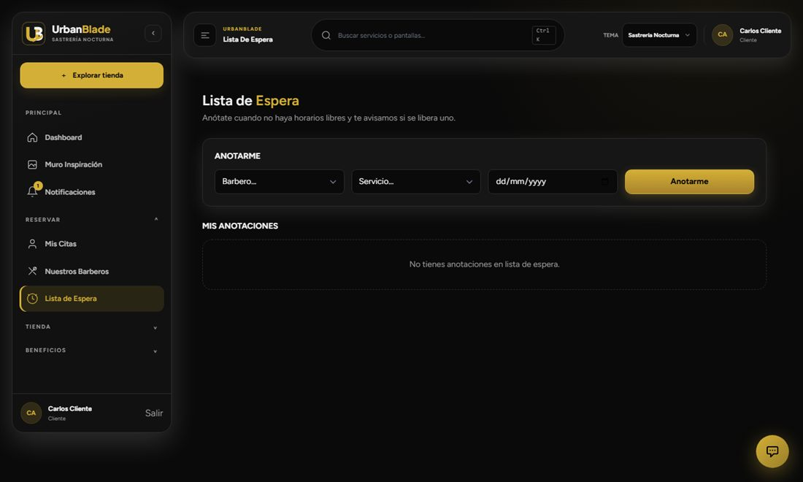

### 3.6 Pagar

Los métodos de pago son **efectivo**, **transferencia** y **tarjeta** (con Stripe). Puedes guardar tarjetas y pagar propinas. En una transferencia se sube el comprobante y la barbería lo revisa antes de darlo por pagado. Los importes, descuentos y puntos los calcula el servidor.

> **Importante** Pagar una cita no es lo mismo que completarla: una cita pagada sigue pendiente de atención hasta que el barbero termine el servicio.

### 3.7 Tienda, carrito, pedidos y recibos

1. En **Tienda** busca por nombre o filtra por categoría y pulsa **Agregar al carrito** en el producto que quieras. Cada tarjeta indica el precio y cuántas piezas hay disponibles.
2. En **Carrito** cambias las cantidades con **−** y **+**, quitas productos con la **×** y revisas el **resumen**. Pulsa **Confirmar pedido**: pagas y recoges en sucursal, y el total final se confirma al momento de la entrega.
3. Sigue tus compras en **Mis Pedidos**. Un pedido no recogido en 3 días se cancela y el producto vuelve al inventario.
4. En **Mis Recibos** ves tu historial de pagos (fecha, servicio, barbero, método y monto), el **total pagado** y descargas cada comprobante en PDF con **Descargar**.

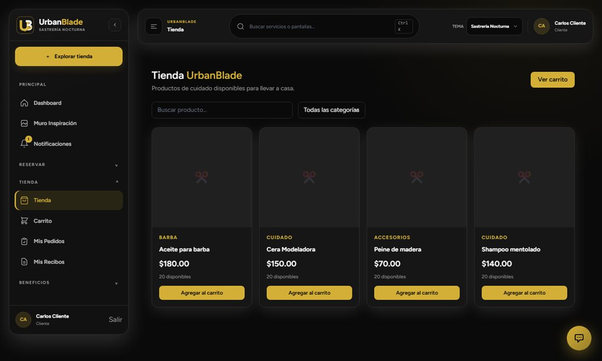

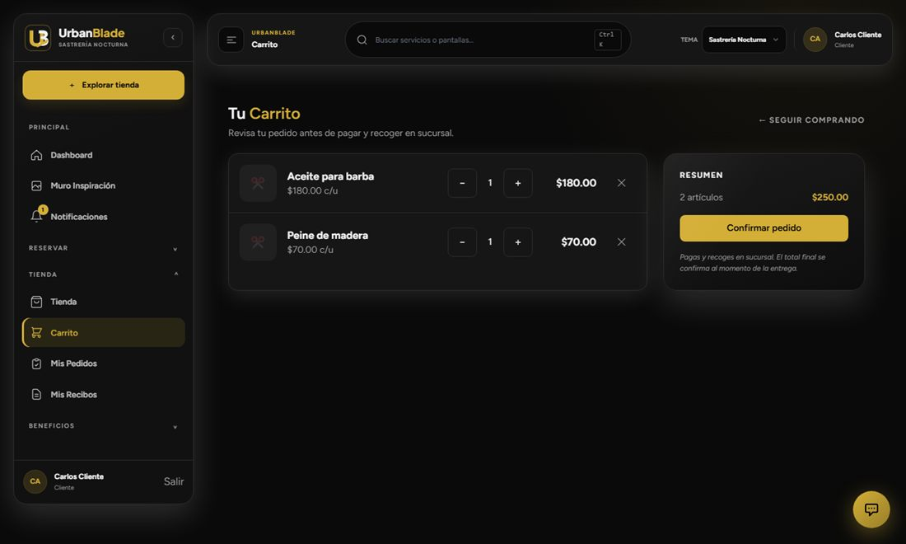

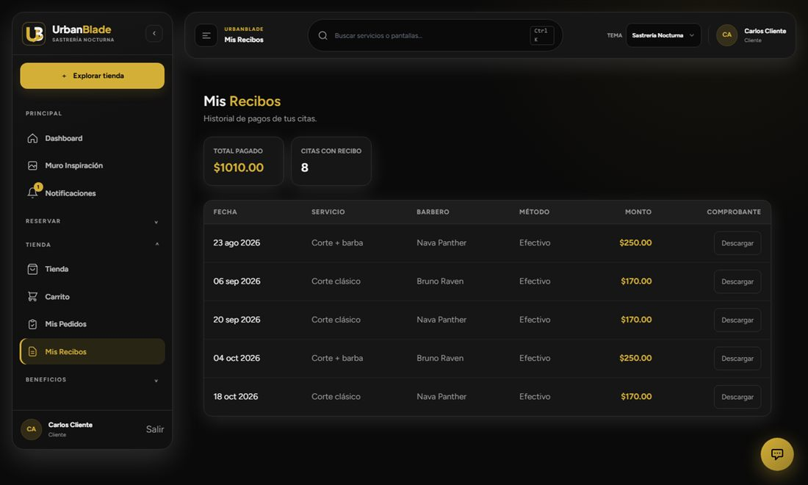

> **Aviso** Los recibos de UrbanBlade son comprobantes del servicio o la compra; **no son facturas fiscales (CFDI)**.

### 3.8 Lealtad, puntos y niveles

Cada cita **completada** suma avance. El nivel sube con las citas completadas y trae un descuento:

| Nivel | Citas completadas | Descuento |
| --- | --- | --- |
| Caballero | 0 | 0 % |
| Regular | 5 | 5 % |
| V.I.P | 10 | 10 % |
| Leyenda | 20 | 15 % |

- Ganas **10 puntos** por cada cita completada y **5 puntos** por una reseña.
- Puedes pagar con puntos hasta el **50 %** del total ya con descuento.
- Si pasas **180 días sin una cita completada** bajas un nivel, y a los **365 días** tus puntos caducan.
- Cada mes hay un **sorteo** entre clientes elegibles.

### 3.9 Membresía, paquetes, gift cards y referidos

- **Membresía:** plan de suscripción de la barbería (por ejemplo, un plan con un porcentaje fijo de descuento en cada servicio mientras esté activa). Se cobra con tarjeta y genera tus recibos de suscripción. Pulsa **Contratar** en el plan que quieras.
- **Paquetes:** compras varios usos de un servicio pagados por adelantado, con saldo y vigencia. Ves el catálogo y **Mis paquetes**.
- **Gift cards:** regalas saldo a otra persona.
- **Referidos:** tu **código** (con el botón **Copiar código**) se lo das a un amigo; cuando él lo use y complete su primera cita, ganas **30 puntos** de lealtad. Si alguien te invitó a ti, escribes su código en **¿A ti te invitó alguien?** y pulsas **Vincular** (solo se puede una vez).

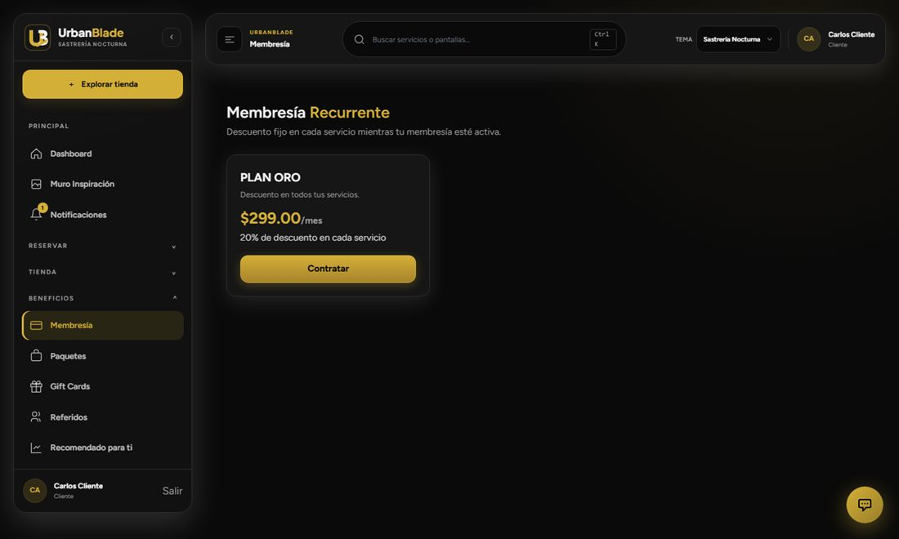

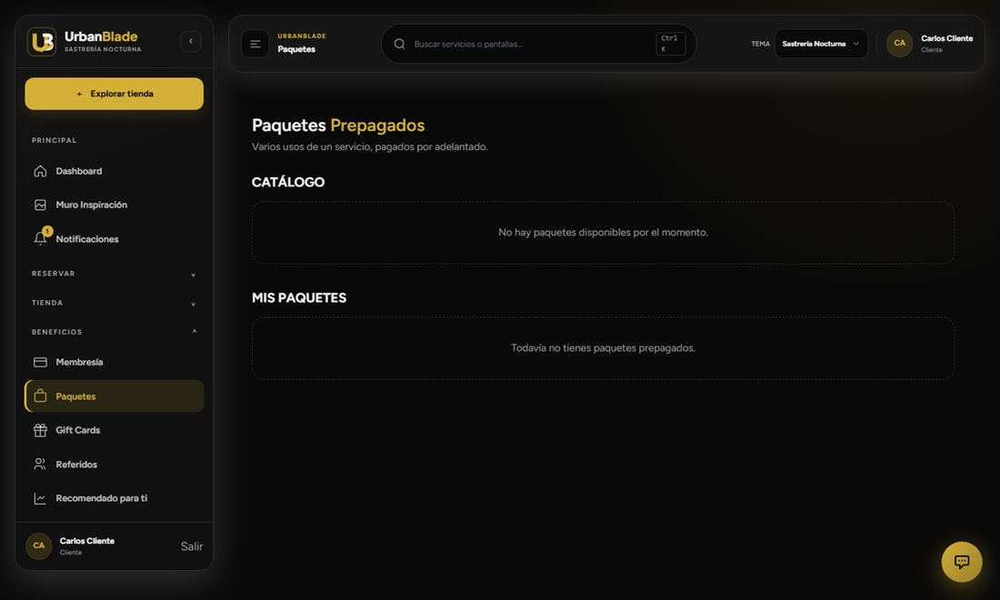

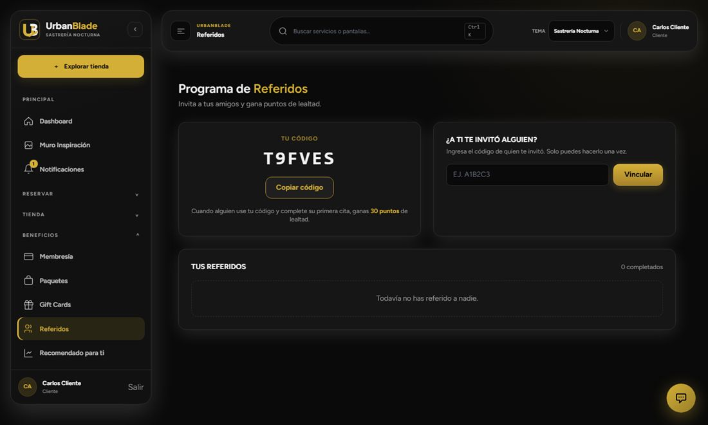

### 3.10 Barberos, reseñas, muro y asistente

- **Nuestros Barberos** muestra al equipo con su especialidad y sus reseñas, para que revises su trabajo antes de reservar.
- Puedes **reseñar** a tu barbero al terminar el servicio.
- El **Muro Inspiración** muestra los trabajos que publican los barberos: puedes reaccionar, guardar y comentar. Los comentarios pasan por moderación y puedes reportar o bloquear contenido. Si todavía no hay publicaciones, verás *Todavía no hay trabajos publicados*.
- El **asistente virtual** (**Bladebot**) vive en el botón redondo de la esquina inferior derecha. Escribe tu pregunta o usa las sugerencias rápidas: *Cuál es mi próxima cita*, *Cuántos puntos tengo*, *Cuáles son los servicios* y *Cómo cancelo mi cita*.

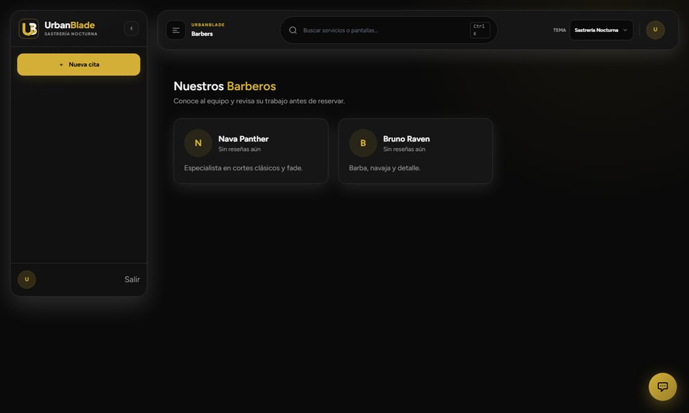

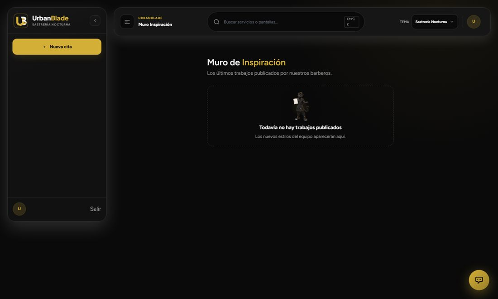

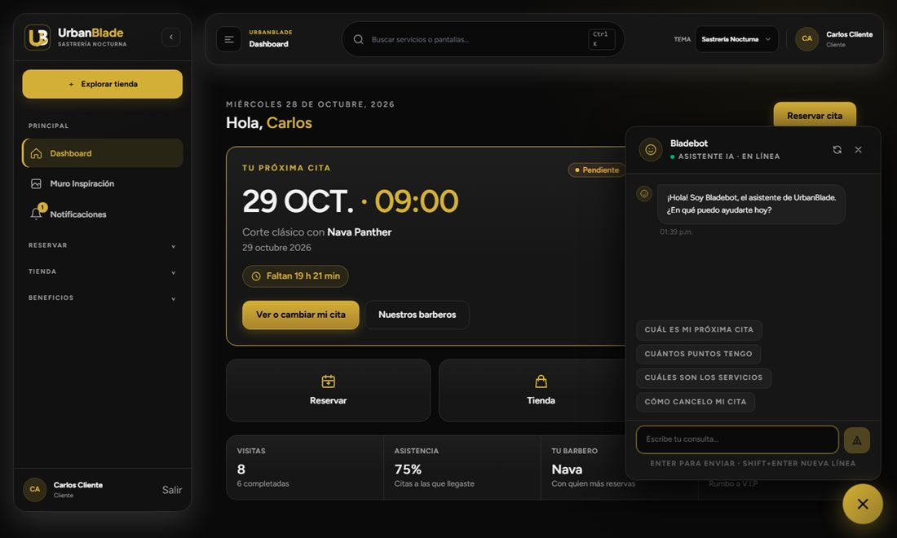

### 3.11 Tu perfil y tus avisos

En **Perfil** (se abre desde tu avatar) ves el avance de tu perfil y tres pestañas: **Información** (tus datos y tu foto), **Seguridad** (contraseña y acceso) y **Cuenta** (zona de peligro). Desde **Notificaciones** ves todos tus avisos; la campana del menú muestra cuántos tienes sin leer. Los recordatorios llegan por correo, por avisos del navegador o de la aplicación y, si están activados, por SMS o WhatsApp.

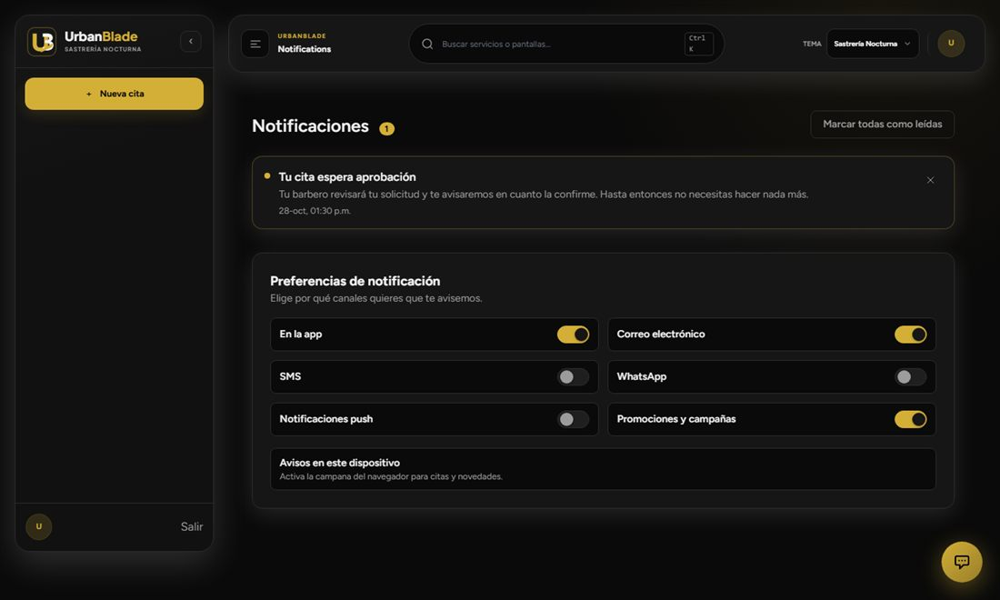

## 4. Rol: Barbero

El menú del barbero tiene **Dashboard**, **Muro Inspiración** y **Notificaciones**, y una sección **Mi Espacio** con **Mi Agenda**, **Mi Calendario**, **Mi Portafolio** y **Mi Horario**. Tu perfil se abre desde tu avatar. El botón principal de la barra lateral dice **Ver mi agenda**.

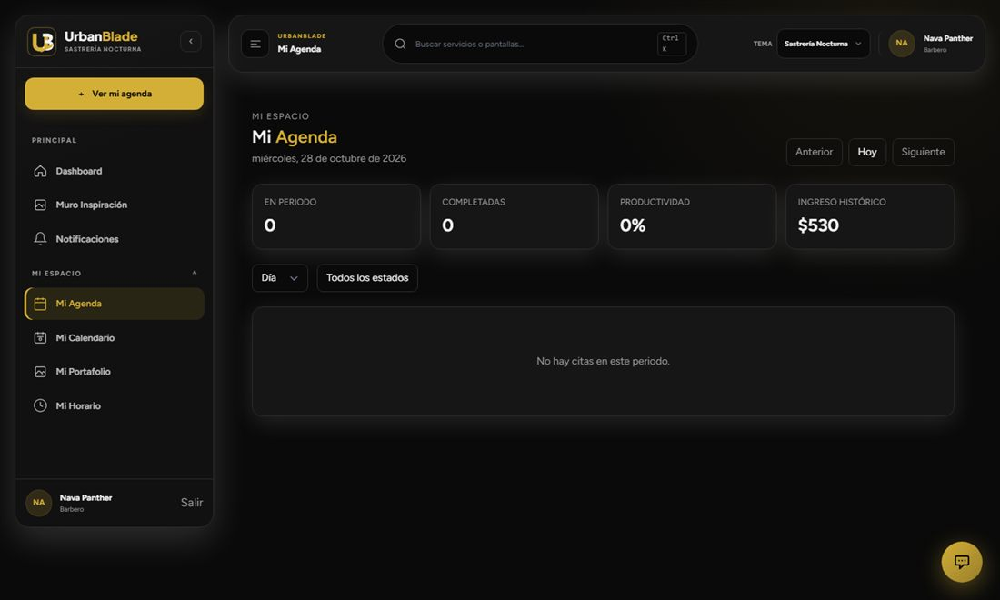

### 4.1 Tu panel

Al entrar ves el panel del día:

- Un saludo con tu avance: *Buen día, Nava. Llevas 1 de 3 citas de hoy. Hay 1 por aprobar.* El aro de la derecha marca cuántas citas del día llevas.
- **Esperando tu aprobación:** las solicitudes de cita nuevas, con hora, fecha, cliente y servicio, y los botones **Aprobar** y **Rechazar**.
- **Tu agenda de hoy:** cada cita con su hora, cliente, servicio, hasta cuándo dura y su estado. El botón de cada cita sirve para **avanzarla**: **Iniciar servicio**, **Terminar servicio** o **No asistió**.

Aprobar una solicitud la pasa de *pendiente* a *confirmada* y avisa al cliente. Si la rechazas, el cliente recibe el aviso de que fue cancelada.

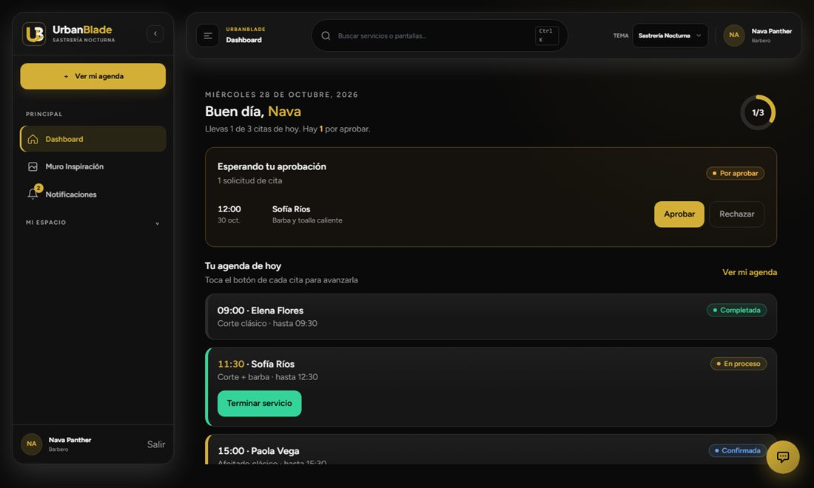

### 4.2 Tu agenda

**Mi Agenda** muestra tus citas del periodo (por defecto, *Hoy*). Navega con **Anterior**, **Hoy** y **Siguiente**, cambia la vista con el selector **Día** y filtra por estado. Arriba tienes cuatro contadores: **En periodo**, **Completadas**, **Productividad** (el porcentaje de citas que completaste) e **Ingreso histórico**.

Cada cita ofrece las acciones que corresponden a su estado:

| Estado | Qué ves y qué puedes hacer |
| --- | --- |
| Confirmada | **Iniciar**, **No asistió** y **Cancelar**. **Iniciar** se habilita desde 15 minutos antes de la hora; antes aparece el aviso *Aún es pronto: la cita es a las 15:00 y podrás iniciarla desde las 14:45*. |
| En proceso | **Terminar ahora**, **+10 min** y **+15 min** para agregar tiempo al servicio. Si te pasas, aparece en rojo cuánto (por ejemplo *Se pasó 99 min*). |
| Completada | **Ver ticket**: el comprobante del servicio. |

Al **iniciar** el sistema valida la fecha, el margen de tiempo y que el pago esté resuelto. Al **completar** se suman puntos al cliente y se registra tu comisión.

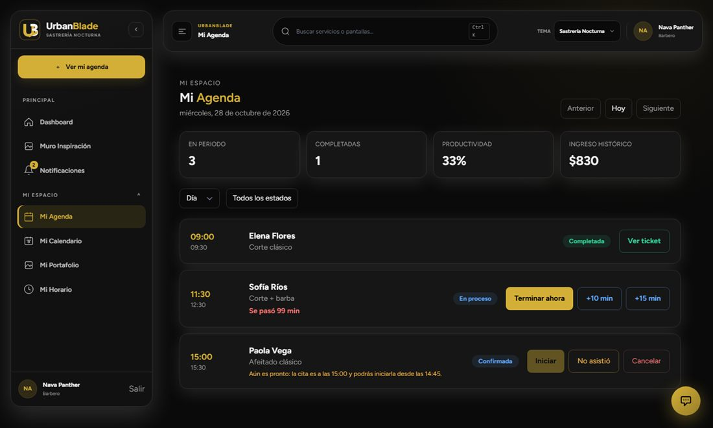

### 4.3 Avisos durante el servicio

Cinco minutos antes de que termine el servicio recibes un aviso con dos opciones: **terminar ya** o **agregar tiempo**. Si el servicio se alarga más de lo esperado, el sistema vuelve a avisarte.

### 4.4 Tu calendario

**Mi Calendario** muestra tus citas por **Mes**, **Semana**, **Día** o **Lista**, con un color por estado: pendiente, confirmada, en proceso, completada, cancelada y no asistió. Cuando un día tiene varias citas se enlistan dentro del día.

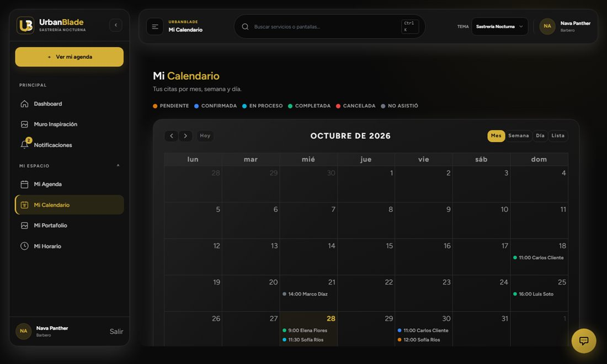

### 4.5 Tu horario

**Mi Horario Laboral** define los días y las horas en que los clientes pueden agendar contigo. Para cada día activas o desactivas el interruptor y eliges la **apertura** y el **cierre**; **Copiar a todos** repite ese horario en los demás días. A la derecha, **Tu semana** resume cómo ven los clientes tu disponibilidad: los días con atención y las horas por semana. Pulsa **Guardar horario** para aplicar los cambios.

> **Importante** La disponibilidad que ven los clientes al reservar sale de este horario y de las citas que ya tienes. Si cambias un día, las reservas nuevas lo respetan de inmediato.

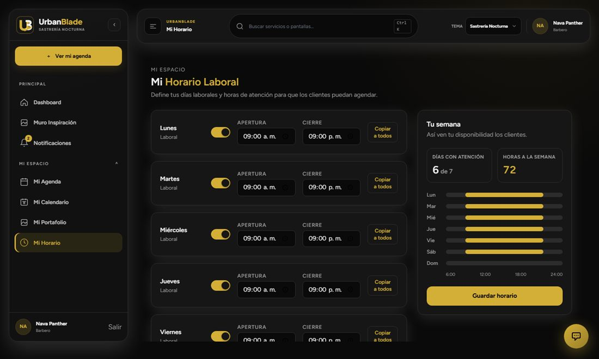

### 4.6 Tu portafolio

**Mi Portafolio** es tu carta de presentación: muestra cuántos **trabajos** has publicado y las **reacciones**, **comentarios** y **guardados** que reciben. Con **+ Publicar trabajo** abres un formulario con el **título** del corte o diseño, una **descripción** opcional y las **fotos y videos** del trabajo (hasta 10 archivos, máximo 50 MB cada uno). Tus publicaciones aparecen en el **Muro Inspiración** que ven los clientes.

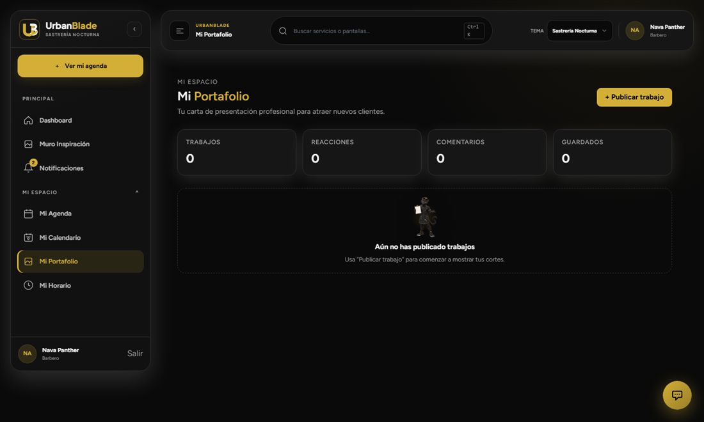

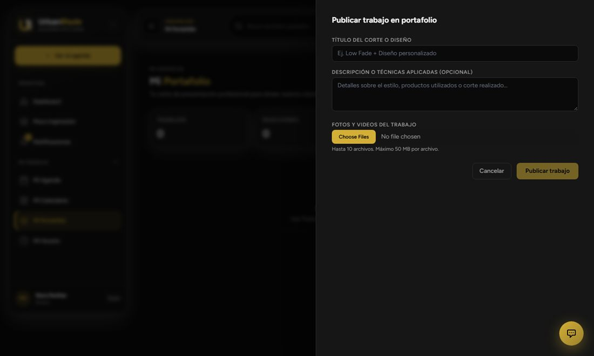

### 4.7 Muro, avisos y perfil

- **Muro Inspiración:** los trabajos publicados por el equipo. Puedes reaccionar, guardar y comentar.
- **Notificaciones:** tus avisos (solicitudes nuevas, cambios y cancelaciones de citas); la campana del menú muestra los que no has leído.
- **Perfil:** se abre desde tu avatar. Ahí cambias tu foto y tus datos, y en **Seguridad** tu contraseña.

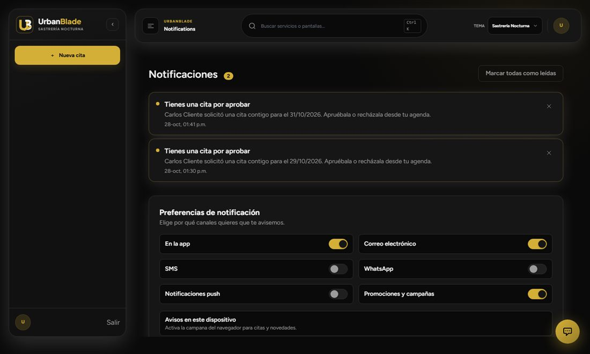

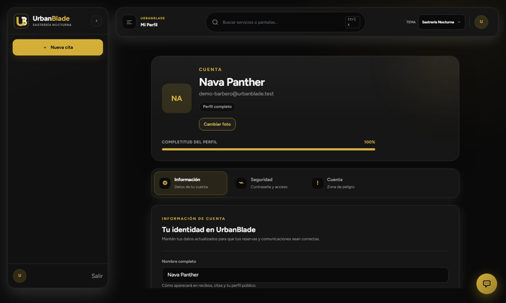

### 4.8 En el teléfono

En el teléfono el menú pasa a una barra inferior con **Dashboard**, **Mi Agenda**, **Mi Calendario**, **Mi Portafolio** y **Más**. Las citas del día y las acciones para avanzarlas se ven igual que en la computadora.

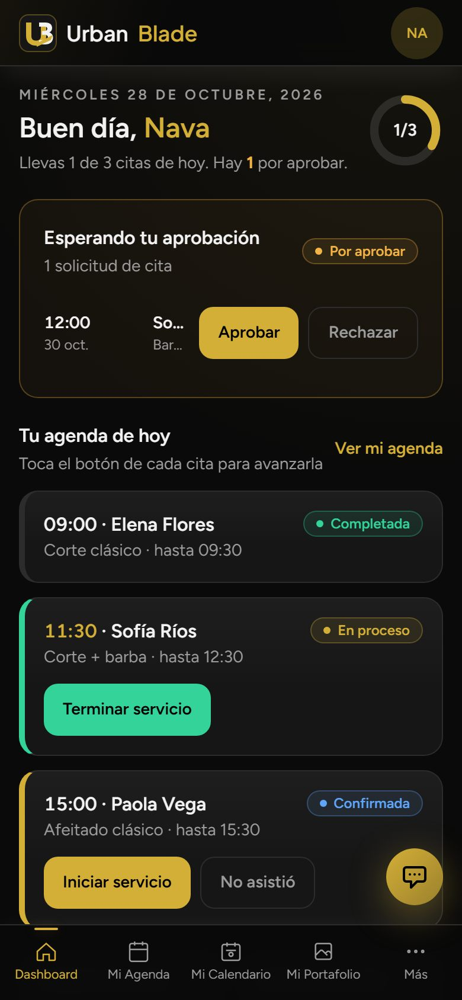

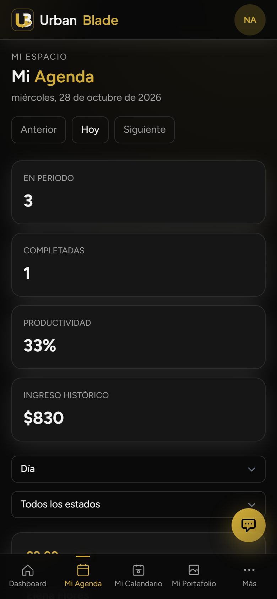

### 4.9 Tu desempeño

Tu agenda muestra tu **productividad** y tu **ingreso histórico**. Además, el administrador recibe cada mes un reporte de desempeño con el mejor mes y las caídas fuertes de cada barbero.

## 5. Rol: Recepcionista

La recepción opera el día a día de la barbería. Su menú tiene **Dashboard**, **Muro Inspiración** y **Notificaciones**, y una sección **Operación** con **Citas**, **Calendario**, **Clientes**, **Pagos**, **Pedidos**, **Movimientos**, **Gift Cards**, **Paquetes**, **Lista de Espera** y **Analítica**. El botón principal de la barra lateral es **Nueva cita**.

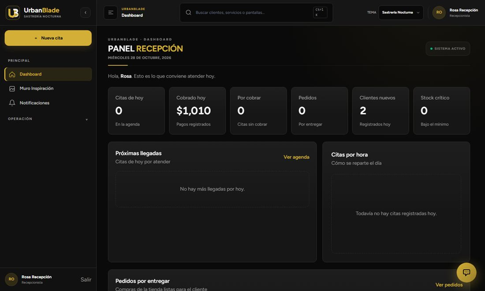

### 5.1 Tu panel

El **Panel Recepción** responde a la pregunta *¿qué conviene atender hoy?*:

- **Seis indicadores:** citas de hoy, cobrado hoy, por cobrar (citas sin cobrar), pedidos por entregar, clientes nuevos y stock crítico.
- **Próximas llegadas:** las citas de hoy que aún están por atender, con hora, cliente, servicio y barbero, y un enlace **Ver detalle**.
- **Citas por hora:** cómo se reparte el día.
- **Pedidos por entregar:** las compras de la tienda listas para el cliente, con un enlace **Ver pedidos**.

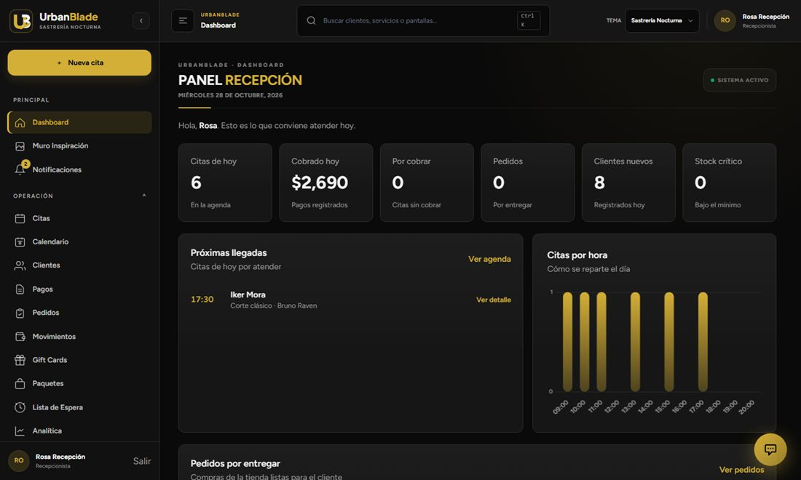

### 5.2 Un día de trabajo

1. Abre **Citas** o **Calendario** y revisa la agenda.
2. **Confirma** las citas pendientes y registra a los clientes que llegan sin cita con **+ Nueva Cita**.
3. Cuando llegue la hora, **inicia**, **completa** o marca **no asistió** según corresponda.
4. **Cobra** desde **Pagos**: efectivo, tarjeta o transferencia (revisa el comprobante).
5. Entrega los **Pedidos** de tienda cuando el cliente los recoge.
6. Al cerrar, haz el **corte de caja** del turno.

### 5.3 Citas y calendario

En **Citas** ves la agenda completa (las 50 citas más recientes), con filtros por estado y por barbero. Las acciones dependen del estado:

| Estado de la cita | Acciones disponibles |
| --- | --- |
| Pendiente | **Confirmar**, **Editar**, **Cancelar** |
| Confirmada | **Iniciar** (solo cuando llega su horario), **Completar**, **No asistió**, **Cobrar**, **Editar**, **Cancelar** |

**+ Nueva Cita** abre un formulario con cliente (búsqueda por nombre o correo), barbero, servicio, fecha, hora, estado y notas. **Calendario** muestra las mismas citas por mes, semana, día o lista, con un color por estado y un filtro por barbero.

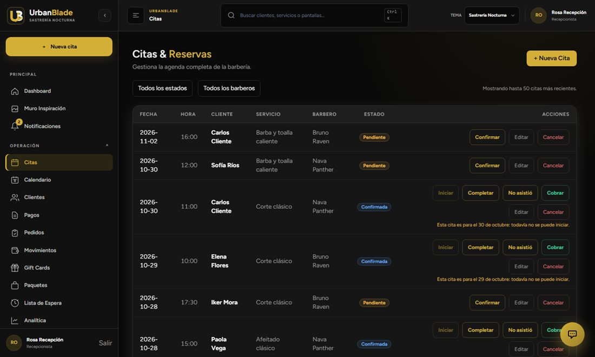

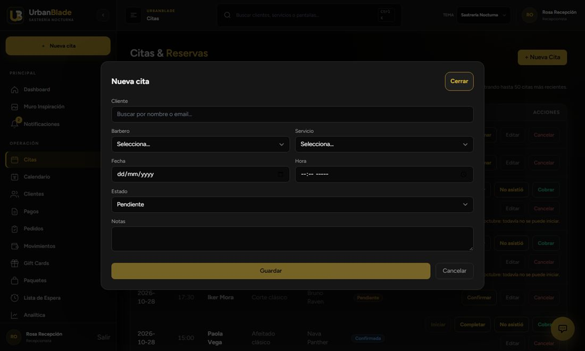

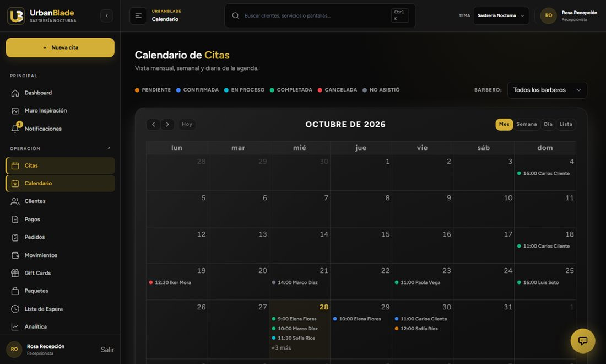

### 5.4 Clientes

**Clientes** lista a las personas registradas con su correo, teléfono, segmento, número de citas y fecha de registro. Puedes buscar por nombre o correo, crear un cliente con **+ Nuevo Cliente** y abrir su **ficha** o **Editar**. La exportación a CSV y la eliminación de clientes son solo del administrador.

La **ficha** resume sus citas, gasto total, ticket promedio, última visita y barbero preferido. Incluye las **Notas del equipo** (alergias, tipo de corte, acuerdos), que solo ve el personal, y el **historial de citas**.

> **Nota** La recepción no puede **eliminar** clientes ni ve los contadores por segmento: esas funciones son del administrador.

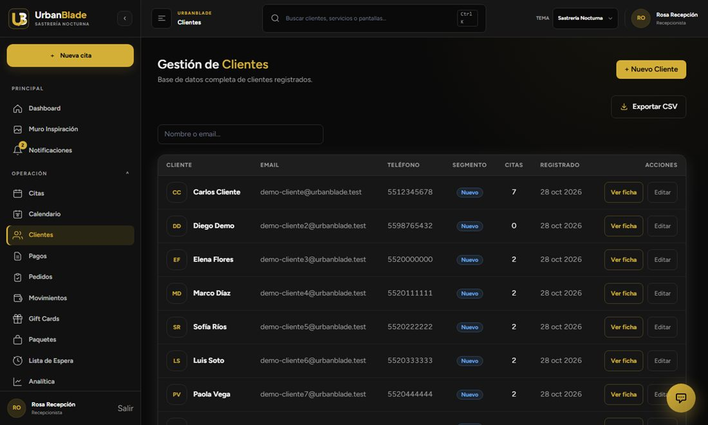

### 5.5 Pagos, cobros y corte de caja

El **Centro de Facturación** muestra la facturación de hoy y del mes, el total de cobros y el desglose por método, con filtros por texto, método, barbero y fechas. Cada cobro lista su folio, cliente, servicio, barbero, método, total y propina, con el botón **PDF** (recibo). **Anular** un cobro es solo del administrador, que debe escribir un motivo; el motivo queda en la bitácora.

- **+ Nuevo Cobro** abre el **Registro de cobro**: eliges la cita pendiente de cobro y registras el pago.
- **Por Revisar** reúne los pagos que esperan verificación, por ejemplo las transferencias con comprobante.
- **Corte de caja** cierra el turno: muestra lo **esperado** (efectivo, tarjeta, propinas y total) y te pide el **efectivo contado**; el sistema calcula la **diferencia**. Agrega observaciones y pulsa **Cerrar caja del día**. Solo el efectivo pasa por el cajón.

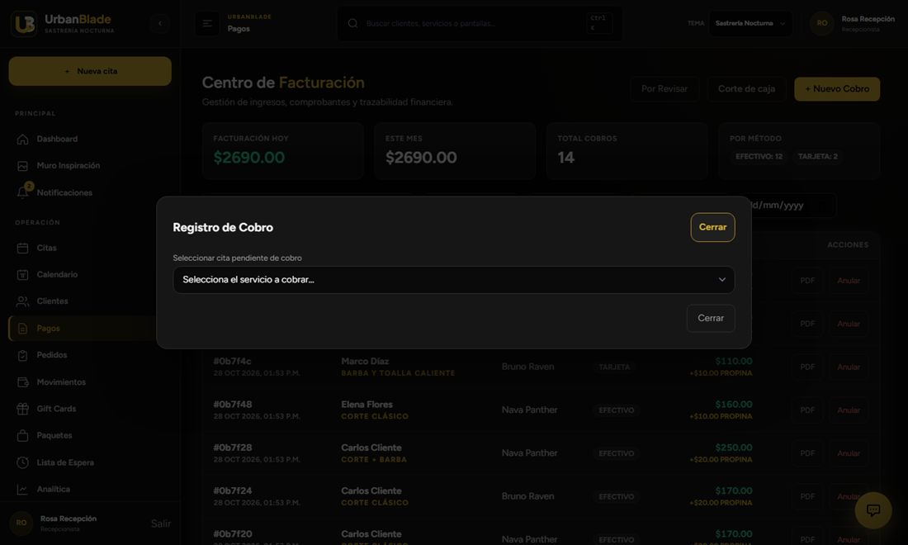

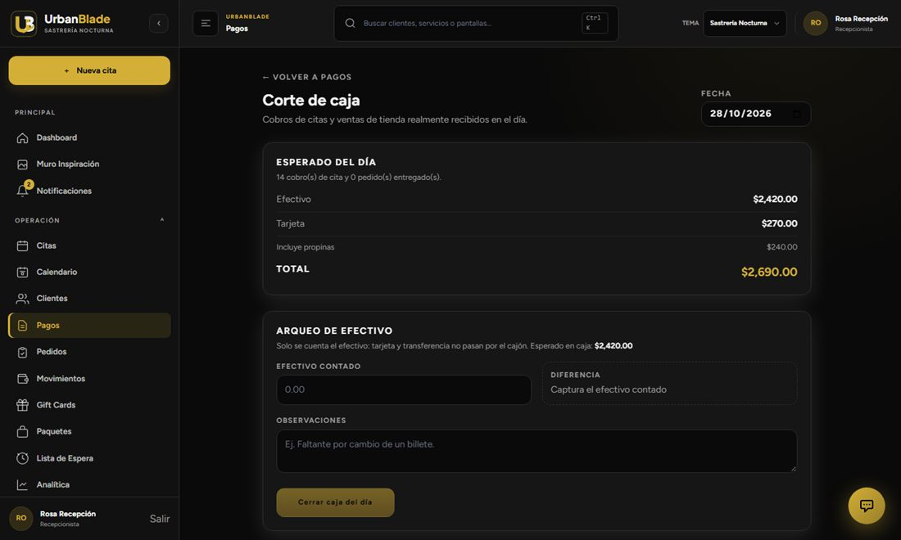

### 5.6 Pedidos, inventario y beneficios

- **Pedidos:** la **Bandeja de Pedidos** gestiona las compras de la tienda (pendientes, entregados y por cobrar). Desde aquí se entrega, se cobra o se cancela un pedido.
- **Movimientos:** historial de entradas y salidas de inventario.
- **Gift Cards, Paquetes y Lista de Espera:** administras las tarjetas de regalo, los paquetes prepagados y las anotaciones de los clientes.
- **Analítica:** el **Centro de Análisis** resume la operación actual (citas de hoy, por confirmar, completadas, pagos por verificar, cancelaciones e inasistencias de los últimos 30 días) y sugiere qué revisar.

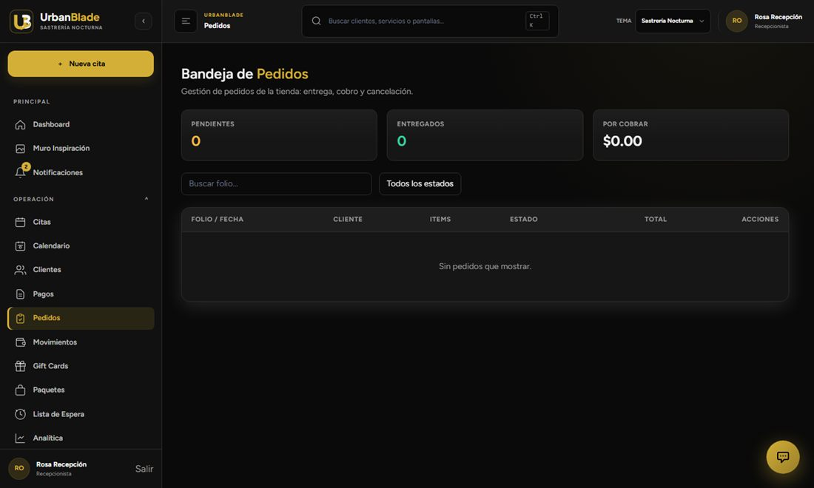

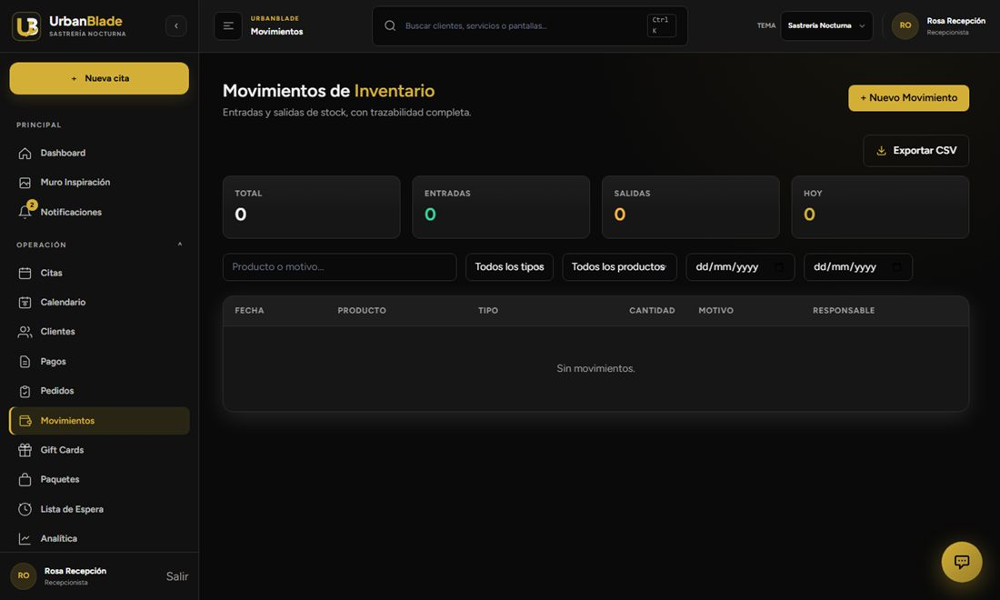

### 5.7 Reglas importantes

- Solo se puede **cobrar** una cita confirmada, en proceso o completada.
- No puedes cambiar un importe a mano para saltarte descuentos o puntos: el servidor calcula el total.
- Los depósitos y los cargos por inasistencia tienen su propio flujo en **Pagos**.
- Las pantallas de **Usuarios**, **Configuración**, **Reportes** y el resto de la administración no forman parte de tu rol. Si abres una por su dirección, el sistema te devuelve al panel.

### 5.8 En el teléfono

En el teléfono el menú pasa a una barra inferior con **Dashboard**, **Citas**, **Pagos**, **Pedidos** y **Más**. Las tablas se desplazan hacia los lados para ver todas sus columnas.

## 6. Rol: Administrador

El administrador tiene el menú más amplio, organizado en secciones que se despliegan al pulsar su nombre.

| Sección | Opciones |
| --- | --- |
| Operación | Citas, Calendario, Clientes, Pagos, Pedidos, Movimientos, Gift Cards, Paquetes, Lista de Espera |
| Gestión | Barberos, Planes de Membresía, Reseñas, Moderación del muro, Usuarios, Servicios, Productos, Configuración |
| Análisis | Analítica, Reportes, Campañas, Sorteos, Logs |
| Sistema | Estado del Servidor |

### 6.1 Tu panel

El **Panel administrativo** reúne lo que necesitas al empezar el día:

- **Accesos rápidos:** Nueva cita, Nuevo cliente, Cobrar y Reportes.
- **Resumen:** citas de hoy, ingresos de hoy, clientes activos y retención, cada uno con su comparación.
- **Gráficas:** ingresos por semana (de las últimas 8 semanas, con la actual resaltada) y servicios más pedidos.
- El botón **Nueva cita** de la barra lateral está disponible en todas las pantallas, y el buscador de la barra superior (**Ctrl + K**) encuentra clientes, servicios y pantallas.

### 6.2 Citas y calendario

En **Citas** ves la agenda completa de la barbería (las 50 citas más recientes), que puedes filtrar por estado y por barbero. Cada fila muestra fecha, hora, cliente, servicio, barbero, estado y las acciones que corresponden a ese estado:

| Estado de la cita | Acciones disponibles |
| --- | --- |
| Pendiente | **Confirmar**, **Editar**, **Cancelar** |
| Confirmada | **Iniciar** (solo cuando llega su horario; antes aparece "todavía no se puede iniciar"), **Completar**, **No asistió**, **Cobrar**, **Editar**, **Cancelar** |

**+ Nueva Cita** abre un formulario con cliente (búsqueda por nombre o correo), barbero, servicio, fecha, hora, estado y notas. Pulsa **Guardar** para crearla.

En **Calendario** ves las mismas citas en vista **Mes**, **Semana**, **Día** o **Lista**, con un color por estado (pendiente, confirmada, en proceso, completada, cancelada y no asistió) y un filtro por barbero. Cuando un día tiene muchas citas, aparece "+N más".

### 6.3 Clientes

**Clientes** muestra la base completa con cuatro contadores por segmento (**VIP**, **Nuevo**, **Activo** e **Inactivo**), un buscador por nombre o correo y los botones **Nuevo Cliente** y **Exportar CSV**. En cada fila: **Ver ficha**, **Editar** y **Eliminar**.

La **ficha** de un cliente resume sus **citas**, el **gasto total**, el **ticket promedio**, su **última visita** y su **barbero preferido**, e incluye:

- **Notas del equipo:** alergias, tipo de corte y acuerdos. Solo las ve el personal; nunca se muestran al cliente.
- **Historial de citas** con fecha, hora, servicio, barbero, estado y precio.

### 6.4 Pagos, cobros y corte de caja

El **Centro de Facturación** muestra la facturación de hoy y del mes, el total de cobros y el desglose por método (efectivo, tarjeta, transferencia). Puedes filtrar por texto, método, barbero y fechas. Cada cobro lista su folio, cliente, servicio, barbero, método, total y propina, con los botones **PDF** (recibo) y **Anular**. Al anular, el sistema pide un **motivo** (mínimo 5 caracteres) que queda en la bitácora junto con el monto; el cobro se borra y no se puede deshacer.

- **+ Nuevo Cobro** abre el **Registro de cobro**: eliges la cita pendiente de cobro y registras el pago.
- **Por Revisar** reúne los pagos que esperan verificación, por ejemplo las transferencias con comprobante.
- **Corte de caja** cierra el día: muestra lo **esperado** (efectivo, tarjeta, propinas incluidas y total) y te pide el **efectivo contado**; el sistema calcula la **diferencia**. Agrega observaciones y pulsa **Cerrar caja del día**. Solo el efectivo pasa por el cajón: la tarjeta y la transferencia no se cuentan.

### 6.5 Pedidos, inventario y beneficios

- **Pedidos:** la **Bandeja de Pedidos** gestiona las compras de la tienda: pendientes, entregados y por cobrar, con búsqueda por folio y filtro por estado. Desde aquí se entrega, se cobra o se cancela un pedido.
- **Movimientos:** historial de entradas y salidas de inventario.
- **Gift Cards, Paquetes y Lista de Espera:** las mismas herramientas que ve el cliente, con la vista del personal para administrarlas.

### 6.6 Personal, servicios y productos

- **Barberos:** lista con su comisión y su estado (**Activo**); **Editar** cambia especialidad, descripción, foto y estado. Un barbero nuevo se crea desde **Usuarios** (el botón dice *Nuevo barbero (vía Usuarios)*).
- **Usuarios:** alta del personal y de cuentas con **Nuevo usuario**: nombre, correo, **rol** (Cliente, Barbero, Recepcionista, Ingeniero o Administrador) y contraseña de al menos 8 caracteres con confirmación. Los roles privilegiados solo los asigna un administrador.
- **Servicios y combos:** el **Catálogo de Servicios** guarda nombre, categoría, duración, precio, imagen (JPG, PNG o WebP de hasta 2 MB) y descripción.
- **Productos:** la **Gestión de Inventario** controla stock, precio y tipo (venta o uso interno), con búsqueda, filtros, **Solo bajo stock** y **Exportar CSV**. **Movimientos** abre el historial.
- **Planes de Membresía:** define los planes que ven los clientes (precio mensual y porcentaje de descuento).

### 6.7 Reseñas y moderación del muro

- **Reseñas de Clientes** reúne las calificaciones que dejan los clientes a sus barberos.
- **Moderación del muro** muestra los comentarios y los reportes de los usuarios y permite ocultar contenido.

### 6.8 Configuración

**Configuración General** agrupa los datos del negocio (nombre, dirección, teléfono, **política de cancelación en horas** y horarios de apertura y cierre), las **redes sociales** y los **datos bancarios** que se muestran para los pagos por transferencia. En la esquina superior derecha está **Activar modo mantenimiento**.

> **Aviso** Un cambio aquí puede afectar reservas, pagos y notificaciones: la política de cancelación y los horarios cambian lo que ven los clientes. El **modo mantenimiento** hace que la aplicación responda con una pantalla de mantenimiento a todos los usuarios: actívalo solo con un aviso previo.

### 6.9 Reportes, analítica, campañas, sorteos y logs

- **Reportes:** el **Centro de Reportes** muestra métricas del periodo que elijas (**Hoy**, **Esta semana**, **Este mes**, **Este trimestre** o **Este año**): ingresos, ticket promedio, citas, finalización, clientes activos, retención, valor del inventario y stock crítico, además de gráficas por estado de cita e ingresos por barbero. Se exportan a Excel o PDF.
- **Analítica:** el **Centro de Análisis** calcula la **operación actual** desde las citas y los pagos registrados (citas de hoy, por confirmar, completadas, pagos por verificar, cancelaciones e inasistencias de los últimos 30 días) y sugiere acciones como *Revisar citas pendientes*.
- **Campañas:** envía una promoción a un **segmento** de clientes (por nivel de lealtad), **ahora** o **programada**, con título, mensaje y botón opcional.
- **Sorteos:** el **Historial de Sorteos** del sorteo mensual de lealtad.
- **Logs:** la **Auditoría** registra la actividad del sistema; muestra totales (hoy, creados, actualizados y eliminados), permite buscar y filtrar por categoría, evento, usuario y fechas, y se exporta a CSV.

### 6.10 Estado del servidor

**Estado del Servidor** es una vista de solo lectura de la salud del sistema: un **resumen del monitor**, un **mapa del sistema** (API, MongoDB, Redis, cola y tareas programadas, con un color según su estado: activo, lento o con fallos, caído o sin uso) y la lista de cada módulo. Se actualiza sola cada 30 segundos o con **Actualizar**.

## 7. Rol: Ingeniero

El ingeniero es un rol técnico de **solo lectura**: revisa la salud del sistema, los reportes y la bitácora, pero **no administra el negocio ni modifica datos**. Su menú tiene **Dashboard** y **Notificaciones**, la sección **Análisis** (**Reportes** y **Logs**) y la sección **Sistema** (**Estado del Servidor**). El botón principal de la barra lateral dice **Revisar sistema**.

### 7.1 Tu panel

El **Panel Ingeniería** lleva dos insignias arriba a la derecha: **Sistema activo** y **Solo lectura**. Contiene:

- **Centro de observabilidad:** un resumen de la infraestructura (por ejemplo *Infraestructura Estable: infraestructura y tareas programadas saludables*) con la latencia de **MongoDB**, el estado de **Redis** y los trabajos **en cola**, y el enlace **Detalle: Monitor** al estado del servidor.
- **Módulos del negocio:** el comportamiento agregado de cada módulo, **sin datos operativos de clientes individuales**: citas e ingresos de las últimas semanas, servicios más pedidos y barberos ocupados o libres. Para más detalle usa Reportes, Logs o el estado del servidor.

### 7.2 Reportes

El **Centro de Reportes** muestra métricas agregadas del periodo que elijas (**Hoy**, **Esta semana**, **Este mes**, **Este trimestre** o **Este año**): ingresos, ticket promedio, citas, finalización, clientes activos, retención, valor del inventario y stock crítico, además de gráficas por estado de cita e ingresos por barbero. Se exportan a Excel o PDF.

### 7.3 Logs

La **Auditoría** registra la actividad del sistema. Muestra totales (**total**, **hoy**, **creados**, **actualizados** y **eliminados**), permite buscar y filtrar por categoría, evento, usuario y fechas, y se **exporta a CSV**. Cada fila indica la fecha, la categoría, el evento, la descripción y el usuario que lo originó.

### 7.4 Estado del servidor

**Estado del Servidor** es una vista de solo lectura de **conectividad, cola y tareas programadas**. Se actualiza sola cada 30 segundos (la hora de la última actualización aparece arriba) o con **Actualizar**.

- **Resumen de monitor:** el estado general (*Entorno estable*) y accesos a **Módulos**, **Reportes** y **Logs**.
- **Mapa del sistema:** un mapa en 3D con la API en el centro y alrededor MongoDB, Redis, la cola y cada tarea programada. El color indica su estado: **activo**, **lento o con fallos**, **caído** o **sin uso**. Puedes girarlo y seleccionar un nodo.
- **Lista de módulos:** a la derecha, el mismo estado en texto (API, MongoDB, Redis, Cola y cada tarea programada, como `appointments:send-reminders` o `loyalty:draw-raffle`).

### 7.5 Avisos y perfil

**Notificaciones** reúne tus avisos y **Perfil** (desde tu avatar) permite cambiar tu foto, tus datos y tu contraseña.

### 7.6 Lo que el ingeniero no puede hacer

Las pantallas de negocio (Clientes, Citas, Pagos, Configuración, Usuarios…) no forman parte de este rol. Si abres una por su dirección, el sistema te devuelve al panel y muestra el aviso *No tienes permiso para abrir esa pantalla*.

Lo que sí ve son **datos agregados** de negocio (por ejemplo ingresos del periodo y valor del inventario en el panel y en Reportes), pero nunca listas de clientes ni datos personales.

### 7.7 En el teléfono

En el teléfono el menú pasa a una barra inferior con **Dashboard**, **Estado del Servidor** y **Más**. El mapa del sistema se muestra más pequeño; para leer cada módulo con comodidad conviene bajar a la lista.

## 8. Pagos, recibos y membresías

| Tema | Cómo funciona |
| --- | --- |
| Efectivo | Se registra en recepción; entra al cierre de caja. |
| Transferencia | El cliente sube el comprobante; recepción lo revisa y lo marca como pagado. |
| Tarjeta | Se procesa con Stripe. Un aviso del proveedor puede completar el pago unos instantes después. |
| Depósito | Anticipo que puede pedir la reserva; se descuenta del total. |
| Inasistencia | Si la barbería lo activa, una cita marcada como *no asistió* puede generar un cargo. |
| Reembolso | Lo emite la barbería; el cliente recibe aviso. |
| Propina | Se agrega al cobrar y queda en el recibo. |

## 9. Notificaciones

La entrega depende de tus preferencias, de los canales activos y de la configuración del dispositivo. Un mensaje de "operación exitosa" no garantiza que el aviso llegue. Si no recibes avisos, revisa **Perfil → Notificaciones** y los permisos del navegador o del teléfono.

## 10. Preguntas frecuentes

| Pregunta | Respuesta |
| --- | --- |
| Reservé y mi cita sigue pendiente. | Es normal: toda cita nueva espera confirmación del barbero o de recepción. |
| No puedo iniciar una cita confirmada. | Aún no corresponde su horario, o falta resolver el pago. |
| Pagué y la cita no se completó. | Pagar no completa el servicio; lo hace el barbero al terminar. |
| ¿Tengo que verificar mi correo con un código? | No. Al crear tu cuenta con tu correo queda lista y entras directamente. |
| Me dice que ya tengo una cita ese día. | Solo se permite una cita por día; elige otra fecha o reagenda la que ya tienes. |
| ¿Puedo reservar sin conexión? | No. La aplicación instalada abre sin red, pero reservar y pagar necesitan internet. |
| ¿Mi recibo es una factura? | No. No es un CFDI. |
| Olvidé mi contraseña. | Usa **¿Olvidaste tu contraseña?** en la pantalla de acceso. |

## 11. Si algo falla

Cuando una operación falle, anota **tu rol, qué intentabas hacer, la fecha y hora y el mensaje que apareció**. No compartas contraseñas, códigos, tokens ni comprobantes de otras personas. Comunícalo a la barbería. Si crees haber encontrado una vulnerabilidad, repórtala por el canal privado de seguridad del proyecto y no la publiques.
