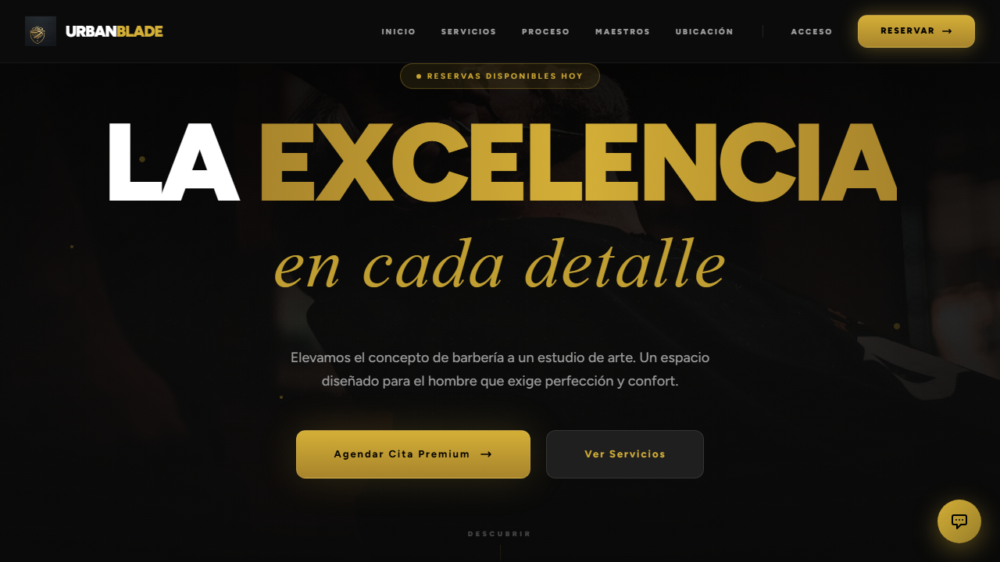
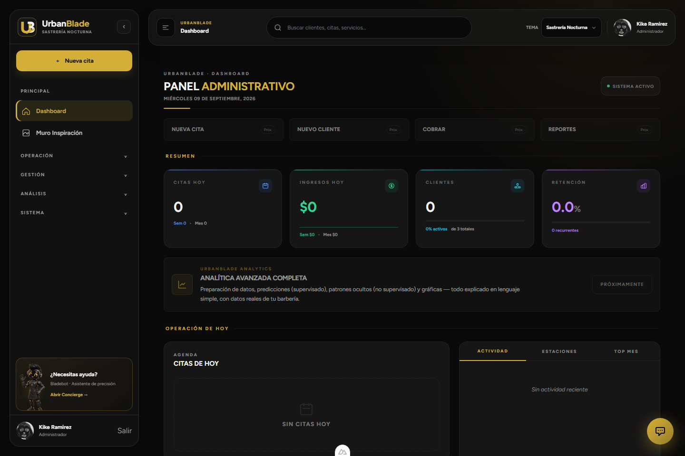

# Guía de demostración de UrbanBlade

Mostrar el producto en un entorno de prueba aislado y con datos ficticios.
La demo se navega en el frontend; este repositorio proporciona la API.

## Preparación

- Usar [clonado](CLONAR_PROYECTOS.md) y [accesos](ACCESOS.md).
- Confirmar el entorno de API, frontend, MongoDB, correo y Stripe.
- Preparar cuentas autorizadas por rol y recursos mínimos desde la aplicación.
- No ejecutar migraciones, seeders o reinicios de servicios operativos para una demo.
- No mostrar contraseñas, tokens, comprobantes reales, consola de secretos ni
  listados de usuarios del negocio.

Las capturas incluidas son ilustrativas y pueden pertenecer a una revisión
anterior del diseño.

## Recorrido sugerido

| Paso | Mostrar | Qué explica |
| --- | --- | --- |
| 1 | Sitio público y catálogo. | Separación entre consulta pública y operación autenticada. |
| 2 | Login y panel de un rol. | Permisos y prioridades distintas por usuario. |
| 3 | Reserva con disponibilidad. | Barbero, servicio, fecha y reglas del backend. |
| 4 | Agenda y estados. | Aprobar, iniciar y completar son operaciones diferentes. |
| 5 | Cobro en sandbox o datos de prueba. | Importe calculado por servidor y conciliación. |
| 6 | Recibos, reportes y notificaciones. | Trazabilidad y operación diaria. |
| 7 | Pruebas y arquitectura. | API, contratos, datos aislados y CI. |

No es necesario realizar un pago para explicar el flujo. Una demo con mocks
debe identificarse como simulada y no presentarse como cobro real.

## Cierre técnico

- [Arquitectura](DOCUMENTACION_TECNICA.md).
- [Pruebas](PRUEBAS.md).
- [Decisiones](DECISIONES.md).
- [Contrato](PLAN_CONTRATO_API.md).

No mostrar el panel académico de Spark como requisito de funcionamiento del
producto si no está configurado en el entorno de la demo.
