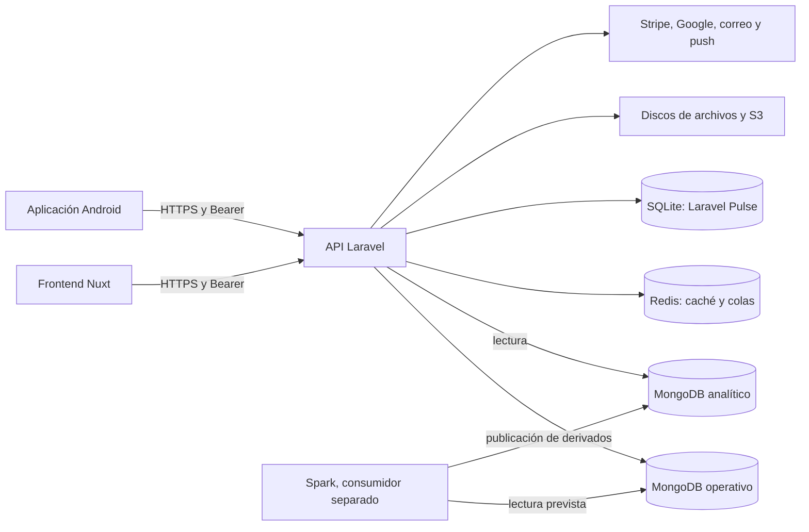

# Arquitectura del backend UrbanBlade

Revisada contra el código del repositorio el 28 de octubre de 2026.
Describe la implementación versionada; no certifica la configuración efectiva de
un servicio remoto ni el estado de sus datos.

## Contexto y límites

UrbanBlade tiene un backend Laravel, un frontend Nuxt y una aplicación Android.
Web y Android consumen HTTP; no reciben credenciales de MongoDB.
El proyecto académico Spark conserva una integración de analítica separada.



El diagrama muestra responsabilidades, no permisos remotos comprobados.
En particular, el código no demuestra los roles efectivos de una cuenta Atlas.

## Estilo y capas

Es un monolito modular por dominios, no una colección de microservicios.
La entrada HTTP está en [routes/api.php](../../routes/api.php).
[bootstrap/app.php](../../bootstrap/app.php) registra middleware, excepciones y rutas.

| Capa | Responsabilidad | Fuente |
| --- | --- | --- |
| Rutas y middleware | Autenticación, mantenimiento, límites y permisos. | [Middleware](../../app/Http/Middleware) |
| Controladores y requests | Orquestación HTTP, validación y alcance del usuario. | [API](../../app/Http/Controllers/Api), [requests](../../app/Http/Requests) |
| Servicios | Reglas y operaciones de negocio. | [Services](../../app/Services) |
| Modelos | Persistencia, relaciones y conversiones. | [Models](../../app/Models) |
| Resources | Forma pública de las respuestas. | [Resources](../../app/Http/Resources) |
| Jobs y notificaciones | Trabajo diferido e integración multicanal. | [Jobs](../../app/Jobs), [Notifications](../../app/Notifications) |

Los controladores también validan pertenencia de recursos; el middleware de rol
por sí solo no establece que una cita, un pago o un perfil pertenezcan al usuario.

## Stack y procesos

Laravel 13 y PHP `^8.3` en Composer; las imágenes usan PHP 8.4.
MongoDB se integra mediante `mongodb/laravel-mongodb`.
Vite, Tailwind CSS 4 y Alpine sirven recursos propios de Laravel.
La interfaz principal está en Nuxt, no en Blade.

[Compose](../../docker-compose.yml) define API PHP-FPM, Nginx, worker, scheduler,
Redis, Mailpit, Ollama y MongoDB de pruebas.
El [overlay de desarrollo](../../docker-compose.development.yml) añade MongoDB
persistente local; no se activa por usar únicamente el Compose base.

La [imagen de staging](../../.docker/staging/Dockerfile) combina PHP-FPM y Caddy.
Su [entrypoint](../../.docker/staging/entrypoint.sh) aplica migraciones al arrancar,
cachea Laravel y puede iniciar el scheduler con `RUN_SCHEDULER=true`.
Por eso arrancar o reemplazar esa imagen es una operación sobre datos, no una
comprobación documental inocua.

## Autenticación y autorización

- El login emite tokens propios en [MobileApiToken](../../app/Models/MobileApiToken.php).
- Se almacena el hash SHA-256, no el token plano. El middleware compara el hash,
  comprueba usuario y expiración y actualiza la actividad.
- La vigencia deslizante es configurable por plataforma: valores predeterminados
  de 30 días web y 180 móvil en [auth.php](../../config/auth.php).
- Logout revoca el token actual; refresh lo sustituye.
- Google web usa Socialite; Android envía un ID token para verificación en el servidor.
- Los roles se resuelven desde el documento de usuario con métodos propios.
  Existen administrador, recepcionista, barbero, cliente e ingeniero.
- `role.custom` y `permission.custom` restringen rutas. Ingeniero tiene
  consultas de operación/observabilidad, no administración de negocio.
- Registro público y alta por Google no permiten elegir un rol administrativo.

Fuentes: [AuthController](../../app/Http/Controllers/Api/Auth/AuthController.php),
[AuthenticateMobileApiToken](../../app/Http/Middleware/AuthenticateMobileApiToken.php),
[User](../../app/Models/User.php), [Google OAuth](GOOGLE_CLOUD_OAUTH.md).

## Persistencia y aislamiento

| Conexión o servicio | Contenido | Límite |
| --- | --- | --- |
| `mongodb` | Usuarios, citas, pagos, inventario y demás operación. | Nombre/URI definidos por entorno. |
| `mongodb_analytics` | Derivados de analítica consumidos por Laravel. | Conexión explícita; sin variables propias hereda la conexión operativa. |
| `mongo-dev`, `rsdev` | Desarrollo local, `urbanblade_dev`. | Persistente; volumen separado. |
| `mongo-test`, `rs0` | Pruebas, `barber_db_test`. | Local y desechable. |
| SQLite de Pulse | Telemetría de Laravel Pulse. | No contiene la fuente de verdad del negocio. |
| Redis | Caché, sesiones o colas según configuración. | No sustituye un respaldo de MongoDB. |

[database.php](../../config/database.php) ejecuta
[DataEnvironmentGuard](../../app/Support/DataEnvironmentGuard.php).
La guarda distingue `shared`, `development` y `testing`, y rechaza mezclas
conocidas de host, entorno y nombre. Esto no sustituye permisos mínimos de Atlas.
[Tests\TestCase](../../tests/TestCase.php) comprueba además ambas conexiones antes
de permitir los métodos de limpieza de las pruebas.

Las transacciones de pagos e inventario necesitan un replica set.
Los borrados lógicos de modelos no liberan necesariamente índices únicos.
Consulta [MongoDB](MONGODB_ATLAS.md) y [ADR-001](ADR-001-ARQUITECTURA-DE-DATOS.md).

## Dominios y reglas relevantes

| Dominio | Servicios principales | Invariantes |
| --- | --- | --- |
| Citas | AppointmentService, AppointmentStatusService, ServiceStartGuard, ServiceTimeService. | Disponibilidad, transiciones válidas, pertenencia y condiciones de inicio. |
| Pagos | PaymentService, DepositService, NoShowFeeService, StripePaymentService, ServiceTicketService. | Importes calculados en servidor; pago y cita tienen estados distintos. |
| Inventario y pedidos | InventoryService, OrderService, CartService. | Precio/stock se releen en servidor; operaciones consistentes. |
| Lealtad y membresías | LoyaltyService, ReferralService, MembershipService. | Descuentos y puntos controlados por reglas del backend. |
| Paquetes y regalos | PackageService, GiftCardService. | Compra, saldo, vigencia y conciliación. |
| Social | Controladores de social, comentarios y moderación. | Autoría, visibilidad, reportes y permisos. |
| Reportes y analítica | ReportService, ReportNarrative, AnalyticsInsightService. | Resultados filtrados por rol y periodo; derivados separados de operación. |
| Comunicación | Notificaciones, FcmPushService, WebPushService, MessagingService. | Entrega depende de canales, credenciales, preferencias y workers. |

### Citas y cobro

[AppointmentStatusService](../../app/Services/Appointment/AppointmentStatusService.php)
define las transiciones:

```text
pendiente  -> confirmada | cancelada
confirmada -> en_proceso | completada | no_asistio | cancelada
en_proceso -> completada | cancelada
completada, cancelada y no_asistio son terminales
```

Cobrar requiere `confirmada`, `en_proceso` o `completada`.
Iniciar tiene reglas adicionales de fecha, margen y pago resuelto.
Cobrar una cita confirmada no equivale a completar el servicio.
Los avisos, extensiones, depósitos y cargos por inasistencia tienen servicios
y pruebas propios; no deben deducirse únicamente del estado de la cita.

### Stripe

El código utiliza Payment Intents, Customers y tarjetas guardadas, reembolsos,
precios/productos y suscripciones de membresía. El webhook atiende también
eventos de suscripción e invoice. La guía anterior que descartaba Billing y
Customers ya no describía la implementación.

El webhook público `POST /api/stripe/webhook` se autoriza mediante la firma
de Stripe, no mediante el token de un usuario.
Consulta [pruebas locales de Stripe](STRIPE_PRUEBAS_LOCALES.md).
No se imprimen claves, firmas ni cuerpos reales de eventos.

## Archivos y datos sensibles

[filesystems.php](../../config/filesystems.php) distingue imágenes públicas y
comprobantes/recibos. Con S3, `receipts` usa URLs temporales de 15 minutos
mediante [ReceiptStorage](../../app/Support/ReceiptStorage.php).
El fallback local comparte `storage/app/public`: no debe describirse como
almacenamiento privado equivalente a S3.

[UploadedImage](../../app/Support/UploadedImage.php) concentra validaciones y
optimización de imágenes. Un Resource o una URL temporal no sustituyen la
autorización para acceder a un comprobante.

## Tareas, observabilidad y errores

[routes/console.php](../../routes/console.php) es la lista vigente del scheduler:
recordatorios, tokens, campañas, stock, no-shows, avisos de servicio, lealtad,
pedidos, cumpleaños, paquetes y lista de espera.

Los jobs necesitan worker; las tareas necesitan scheduler. Evita duplicar
scheduler al escalar servicios.
[observability.php](../../config/observability.php), LogSlowRequests y Pulse cubren
peticiones/consultas y operación. Sentry depende de la configuración del entorno.
Nunca registrar cabeceras de autorización, URIs con credenciales ni datos de pago.

## Contrato, pruebas y decisiones

- [Contrato API](PLAN_CONTRATO_API.md): endpoints, ejemplos y coordinación con clientes.
- [Pruebas](PRUEBAS.md): entornos, matriz, comandos y límites de evidencia.
- [Decisiones](DECISIONES.md): decisiones implementadas y propuestas separadas.
- [CI/CD](CI_CD.md): controles y límites de publicación.
- [Seguridad documental](SEGURIDAD_DOCUMENTACION.md): alcance del escaneo y saneamiento.
